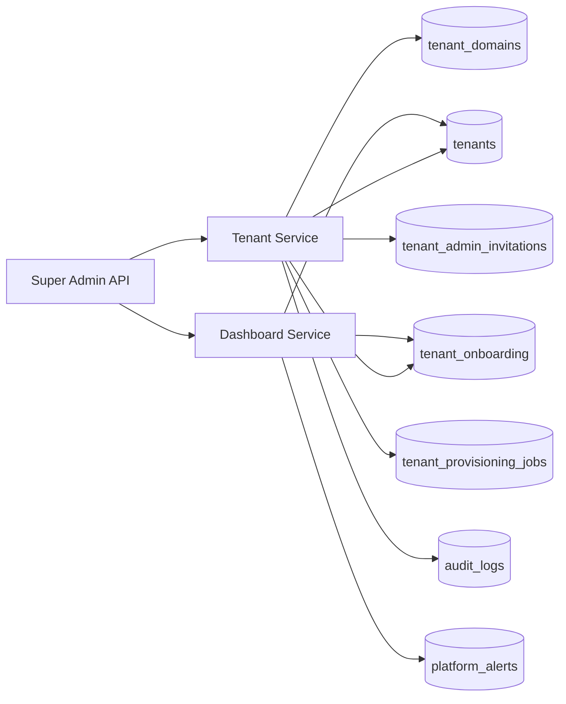
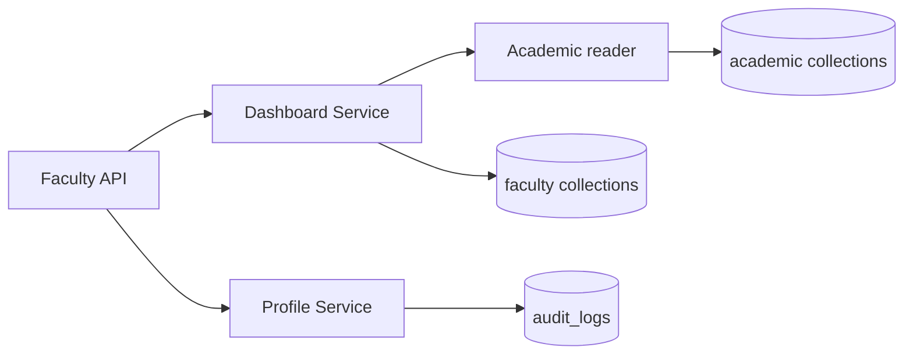
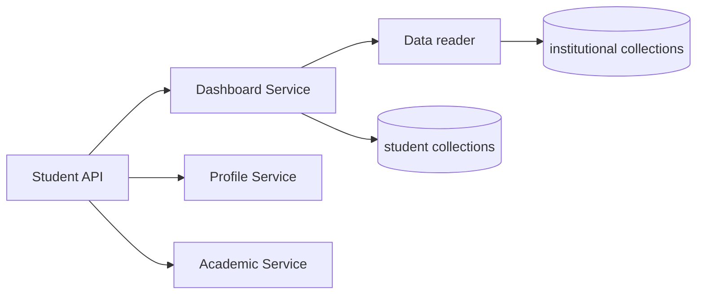
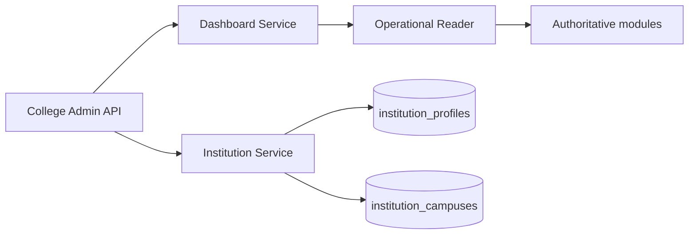

# College ERP — Backend Architecture (living doc)

## Current shape

- **Modular monolith** (`backend/app/modules/*`)
- **API version** `/api/v1`
- **Multi-tenant** shared MongoDB database with `tenant_id` on college-owned data
- **Auth** centralized JWT access tokens + rotating refresh tokens
- **Authorization** role → permission map (`app/authorization/permissions.py`)
- **Async jobs** Celery + RabbitMQ
- **Cache / rate limits** Redis

## Layers

1. Routers — HTTP only, envelope responses on active modules
2. Services — business rules and workflows
3. Repositories — tenant-scoped data access
4. Models — Beanie documents
5. Audit — `audit_logs` for security-sensitive actions

## Super Admin (Phase 1–2)

### Phase 1 — implemented

- **Platform module** (`app/modules/platform`) — dashboard, health summaries, alerts, activity feed
- **Tenant onboarding** (`app/modules/tenants`) — registration, provisioning saga, admin invitations
- **Platform collections** — see `docs/PLATFORM_DATABASE.md` and `docs/TENANT_ONBOARDING.md`

### Phase 2 — implemented

- **Lifecycle** (`lifecycle_service`, `/tenants/{id}/lifecycle`) — activate/suspend/reactivate, offboarding initiation, scheduled ops
- **Configuration** (`app/modules/configuration`) — allowlisted platform/tenant settings, branding, feature flags, domain verification tokens
- **Suspension enforcement** — login + API gate, refresh token revocation

### Phase 3 — implemented

- **Platform identity** — operator profiles, invitations, sessions, access reviews (`/platform/operators`)
- **Effective permissions** — `authorization/resolver.py` + `AccessScope.effective_permissions`
- **Platform security** — `security_events`, `platform_audit_logs`, export (`/platform/security`, `/platform/audit`)
- **Support access** — approval workflow + `X-Support-Session` header (`/platform/support-access`)

### Phase 4 — implemented

- **Operations** — health probes, incidents, job registry (`/platform/operations`)
- **Integrations** — provider catalog, config + credential refs, webhook delivery tracking (`/platform/integrations`)
- **SSRF / secrets** — `core/url_safety.py`, `core/secrets.py`

### Phase 5 — implemented

- **Data governance** — export requests/jobs, private artifacts, expiring download tokens, offboarding workflow, retention, legal holds, deletion manifests (`/platform/tenants/{id}/exports`, `/platform/tenants/{id}/offboarding`)
- **Subscriptions** — plans, entitlements, tenant subscriptions, webhook idempotency (`/platform/subscriptions`; disable via `SAAS_BILLING_ENABLED=false`)

## Not in scope yet (deferred)

CI/CD, Prometheus/Grafana, production Nginx/TLS automation, full module catalogue, master data modules, external incident/integration feeds.

### Faculty — Phase 1 — implemented

- **Faculty module** (`app/modules/faculty`) — `/faculty/me/*` dashboard and profile APIs
- **Academic read models** (`app/modules/academics/models.py`) — authoritative timetable, assessments, attendance queue for aggregation
- **Collections** — see `docs/FACULTY_PHASE1.md`

### Faculty — Phase 2 — implemented

- **Course content** — `/faculty/me/academic-content/*` (assigned courses, syllabus, outcomes, roster, coverage)
- **Timetable** — `/faculty/me/timetable/*` (daily/weekly, sessions, calendar, conflicts, update requests)
- **Academic authority** — `app/modules/academics/curriculum_models.py` + extended `timetable_entries` / `class_sessions`
- See `docs/FACULTY_PHASE2.md`

### Faculty — Phase 3 — implemented

- **Attendance** (`app/modules/attendance`) — sessions, records, policy engine, corrections
- **LMS** (`app/modules/lms`) — materials, assignments, submissions, evaluations
- **Faculty routes** — `/faculty/me/attendance/*`, `/faculty/me/lms/*` via `phase3_router.py`
- See `docs/FACULTY_PHASE3.md`

### Faculty — Phase 4 — implemented

- **Examinations** (`app/modules/examinations`) — assessments, components, marks batches, grading policy
- **Student support** — mentoring, counselling, follow-ups, reports (`faculty/support_models.py`)
- **Faculty APIs** — `/faculty/me/assessments/*`, `/faculty/me/student-support/*`
- See `docs/FACULTY_PHASE4.md`

### Faculty — Phase 5 — implemented (portal complete)

- **Communication** — announcements, messages, notifications, delivery logs
- **Self-service** — employment snapshot, leave (`hr`), payslips (integration-gated), personal docs/reports
- **HR module** (`app/modules/hr/models.py`) — central leave and payslip references
- See `docs/FACULTY_PHASE5.md`

### Student — Phase 1 — implemented

- **Student module** (`app/modules/students`) — `/students/me/*` dashboard, profile, academics
- **Collections** — see `docs/STUDENT_PHASE1.md`
- **Integrations** — read-only aggregation from academics, attendance, LMS, examinations, communication

### Student — Phase 2 — implemented

- **Curriculum reads** — `/students/me/curriculum/*` via `curriculum_service.py` + `course_access.py`
- **Registration** — `/students/me/registration/*` via `registration_service.py`
- **Collections** — see `docs/STUDENT_PHASE2.md`

### Student — Phase 3 — implemented

- **Timetable** — `/students/me/timetable/*` (`timetable_service.py`, `integrations/timetable_reader.py`)
- **Attendance** — `/students/me/attendance/*` (`attendance_portal_service.py`)
- See `docs/STUDENT_PHASE3.md`

### Student — Phase 4 — implemented

- **CIA / internal marks** — `/students/me/cia/*` (`cia_service.py`)
- **Assignments & continuous assessment** — `/students/me/assessments/*` (`continuous_assessment_service.py`)
- See `docs/STUDENT_PHASE4.md`

### College Admin — Phase 6 — implemented

- **HR administration** — `/college-admin/hr-administration/*` (policies, recruitment, onboarding/offboarding, leave approval, payroll config status)
- **Library administration** — `/college-admin/library-administration/*` (branches, catalogue, copies, circulation, fines, acquisitions)
- See `docs/COLLEGE_ADMIN_PHASE6.md`

### College Admin — Phase 5 — implemented

- **Examination administration** — `/college-admin/examination-administration/*` (config, sessions, eligibility, hall tickets, marks review, result publish)
- **Finance administration** — `/college-admin/finance-administration/*` (structures, assessments, payments, reconciliation, refunds, periods)
- See `docs/COLLEGE_ADMIN_PHASE5.md`

### College Admin — Phase 4 — implemented

- **Faculty & employee administration** — `/college-admin/faculty-administration/*`
- **Attendance administration** — `/college-admin/attendance-administration/*` (policies, monitoring, correction approval, compliance)
- See `docs/COLLEGE_ADMIN_PHASE4.md`

### College Admin — Phase 3 — implemented

- **Academic configuration** — `/college-admin/academic-config/*` (years, terms, calendars, programmes, regulations, courses, sections, publish + history)
- **Student administration** — `/college-admin/student-administration/*` (admissions, records, enrollment, status, transfer, promotion, guardians, bulk import)
- **Integration** — syncs `AcademicYearContext`, `StudentProfile`, `StudentEnrollment`, `CourseRecord`, `GradingPolicy` / attendance policy references on publish
- See `docs/COLLEGE_ADMIN_PHASE3.md`

### College Admin — Phase 2 — implemented

- **User & role management** — `/college-admin/users*`, `/college-admin/roles*`, invitations, suspend/activate, custom roles, access history
- **Organization management** — `/college-admin/departments*`, `/college-admin/organization/units*`, hierarchy closure, head assignments
- **RBAC overlay** — `authorization/resolver.py` merges `institution_role_assignments` permissions
- See `docs/COLLEGE_ADMIN_PHASE2.md`

### College Admin — Phase 1 — implemented

- **College Admin module** (`app/modules/college_admin`) — `/college-admin/*` dashboard and institution APIs
- **Institution collections** — profiles, campuses, settings, branding, configuration versions, activity logs
- See `docs/COLLEGE_ADMIN_PHASE1.md`

## Next implementation phases

1. College Admin Phase 4+ (remaining institutional writers per roadmap)
2. Student Phase 5+ (LMS submit flows, finance, fee detail)
3. Academic Management write APIs (populate timetable, assessments)
4. HR/Payroll admin APIs (leave approval, payslip ingestion) and student-facing portals
5. Remaining Super Admin modules (billing, support, feature flags, …)
6. Remaining ERP domains per roadmap
