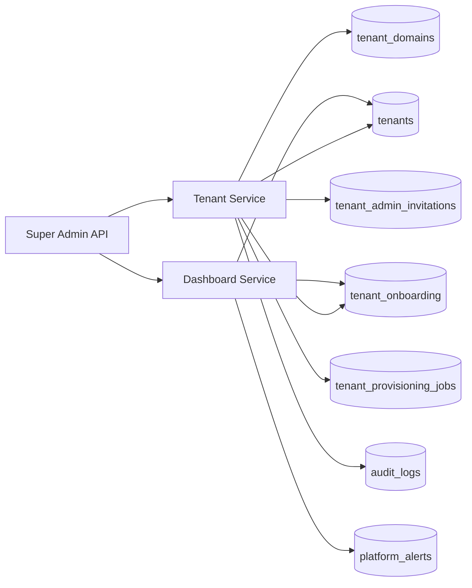

# College ERP — Backend Architecture (living doc)

## Current shape

- **Modular monolith** (`backend/app/modules/*`)
- **API version** `/api/v1`
- **Multi-tenant** shared MongoDB database with `tenant_id` on college-owned data
- **Auth** centralized JWT access tokens + rotating refresh tokens
- **Authorization** role → permission map (`app/authorization/permissions.py`)
- **Async jobs** Celery + RabbitMQ
- **Cache / rate limits** Redis

## Layers

1. Routers — HTTP only, envelope responses on active modules
2. Services — business rules and workflows
3. Repositories — tenant-scoped data access
4. Models — Beanie documents
5. Audit — `audit_logs` for security-sensitive actions

## Super Admin (Phase 1–2)

### Phase 1 — implemented

- **Platform module** (`app/modules/platform`) — dashboard, health summaries, alerts, activity feed
- **Tenant onboarding** (`app/modules/tenants`) — registration, provisioning saga, admin invitations
- **Platform collections** — see `docs/PLATFORM_DATABASE.md` and `docs/TENANT_ONBOARDING.md`

### Phase 2 — implemented

- **Lifecycle** (`lifecycle_service`, `/tenants/{id}/lifecycle`) — activate/suspend/reactivate, offboarding initiation, scheduled ops
- **Configuration** (`app/modules/configuration`) — allowlisted platform/tenant settings, branding, feature flags, domain verification tokens
- **Suspension enforcement** — login + API gate, refresh token revocation

### Phase 3 — implemented

- **Platform identity** — operator profiles, invitations, sessions, access reviews (`/platform/operators`)
- **Effective permissions** — `authorization/resolver.py` + `AccessScope.effective_permissions`
- **Platform security** — `security_events`, `platform_audit_logs`, export (`/platform/security`, `/platform/audit`)
- **Support access** — approval workflow + `X-Support-Session` header (`/platform/support-access`)

### Phase 4 — implemented

- **Operations** — health probes, incidents, job registry (`/platform/operations`)
- **Integrations** — provider catalog, config + credential refs, webhook delivery tracking (`/platform/integrations`)
- **SSRF / secrets** — `core/url_safety.py`, `core/secrets.py`

### Phase 5 — implemented

- **Data governance** — export requests/jobs, private artifacts, expiring download tokens, offboarding workflow, retention, legal holds, deletion manifests (`/platform/tenants/{id}/exports`, `/platform/tenants/{id}/offboarding`)
- **Subscriptions** — plans, entitlements, tenant subscriptions, webhook idempotency (`/platform/subscriptions`; disable via `SAAS_BILLING_ENABLED=false`)

## Not in scope yet (deferred)

CI/CD, Prometheus/Grafana, production Nginx/TLS automation, full module catalogue, master data modules, external incident/integration feeds.

## Next implementation phases

1. Complete institutional master data (campus, programme, academic year, …)
2. Student + enrollment workflows
3. Remaining Super Admin modules (billing, support, feature flags, …)
4. Remaining ERP domains per roadmap
