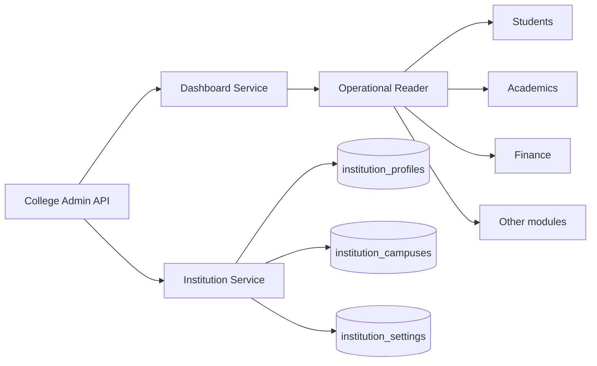

# College Admin Phase 1

## Scope

- **College Admin Dashboard** (`/api/v1/college-admin/dashboard*`)
- **Institution & Campus Settings** (`/api/v1/college-admin/institution*`)

## Security

| Permission | Purpose |
|---|---|
| `college:dashboard:read` | Dashboard aggregation |
| `college:institution:read` | Profile, campuses, settings read |
| `college:institution:manage` | Profile update |
| `college:campus:manage` | Campus create/update |
| `college:settings:read` | Settings and configuration history |
| `college:settings:manage` | Permitted settings and branding |

College Admin role includes all permissions above. Every query is scoped to `AccessScope.tenant_id`.

Platform-controlled tenant fields (code, lifecycle, subscription) are not writable via these APIs. Institution settings use an allowlist (`settings_registry.py`).

## MongoDB collections

| Collection | Purpose |
|---|---|
| `institution_profiles` | Extended institution identity |
| `institution_campuses` | Multi-campus records |
| `institution_settings` | Academic display and locale preferences |
| `institution_branding` | Tenant branding (synced to `tenant_branding`) |
| `institution_configuration_versions` | Versioned snapshots (1y TTL index) |
| `college_dashboard_preferences` | Per-admin UI filters (reserved) |
| `institution_activity_logs` | Institutional admin activity |

## Dashboard data sources

Counts and summaries are read from authoritative module collections (students, faculty, HR, academics, attendance, finance, library, hostel, integrations) filtered by `tenant_id`. Missing modules return zero/empty structures rather than cross-tenant scans.

## Tests

```bash
cd backend
pytest tests/test_college_admin_phase1.py tests/test_permissions.py -q
```

## Architecture


