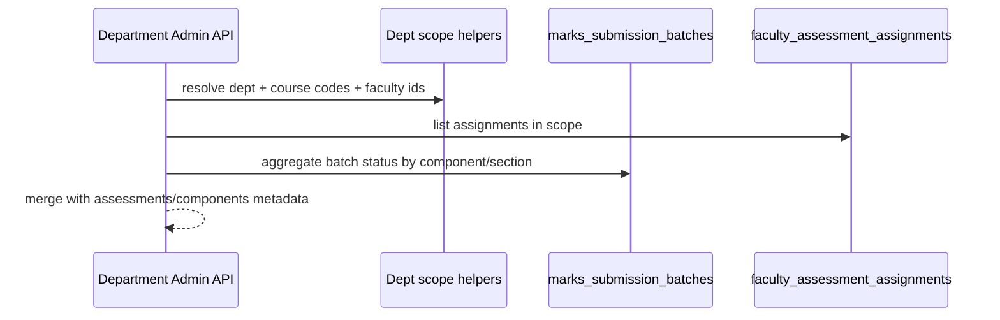

# Department Admin — Phase 5 (Planning)

**Status:** Phase **5.1–5.6 implemented** (Module 1 coordination + Module 2 performance monitoring). Ready for stakeholder review; not production-ready without Mongo integration CI.

**Baseline:** Phases 1–4 are conditionally accepted as the current Department Admin implementation. Phase 4 gaps (room master, lab groups, timetable change auto-apply) are **out of scope** for Phase 5 unless a direct read dependency is documented below.

**Engineering reference:** Follow `ENGINEERING_GUIDE.md` (request → service → data access, tenant isolation, least privilege, tests before production claims).

---

## 1. Scope and objectives

Phase 5 adds **coordination and monitoring** for the department — not ownership of examination cell operations.

| Module | Objective |
|--------|-----------|
| **1 — Assessment & Examination Coordination** | Visibility into schedules, internal assessment progress, marks submission status, examination readiness signals, faculty coordination, and departmental issue logging — without duplicating College Admin / Examination Cell marks entry, approval, or result publication. |
| **2 — Academic Performance Monitoring** | Department-level aggregates and drill-downs from **official** results, grading, attendance, enrollment, and institutional academic records; authorized support indicators; **reuse** Phase 3 student follow-ups — no second grading engine. |

**API prefix (consistent with Phases 1–4):** `/api/v1/department/*` via `department_admin.router`.

**Out of scope (Phase 5):**

- Marks entry, batch approval, eligibility publishing, hall tickets, result publication (`college:examination:*`).
- New authoritative marks, examination, result, or grading collections.
- Phase 4 timetable/attendance gap resolution (documented in `DEPARTMENT_ADMIN_PHASE4_REVIEW.md`).
- Phase 6+ (calendar, comms, resources, etc.).

---

## 2. Module requirements

### Module 1 — Assessment & Examination Coordination

#### 2.1 Assessment schedule overview

**Must show (when source data exists):**

- Upcoming internal/CIA items from `upcoming_assessments` (scoped to department faculty).
- Canonical assessment metadata from `assessments` + `assessment_components` when linked via `faculty_assessment_assignments` / `course_code` in department course set.
- Programme, batch, section: join `StudentProfile` / `EnrollmentRosterEntry` / assignment `section` — not all sources carry programme; response fields optional with `null` + `data_basis` metadata.
- Responsible faculty, scheduled date/time, assessment type (`assessment_type` / `component_type`).
- **Submission deadline:** derive from `assessment_components` + institution config if present; else from `upcoming_assessments.metadata` or `PendingAssignmentEvaluation.due_at` — **do not invent** a default deadline policy.

**Filters:** `academic_year_label`, `semester_label`, `programme_code`, `batch_label`, `section_code`, `course_code`, `assessment_type`, `date_from`, `date_to`, pagination.

#### 2.2 Internal assessment monitoring

Track **read-only** status derived from authoritative records:

| Concern | Primary sources |
|---------|-----------------|
| Assessment defined | `assessments`, `assessment_components` (tenant) |
| Faculty assigned | `faculty_assessment_assignments` (dept faculty filter) |
| Marks workflow | `marks_submission_batches` (`MarksBatchStatus`), `marks_approval_history`, `examination_marks` (college review overlay) |
| Student marks | `student_assessment_marks` — **visibility gated** (see §5) |
| Operational pending eval | `pending_assignment_evaluations` (dashboard already uses this) |

**Completion:** An assessment/component is “complete” only when batch status is `approved` (or assessment `final_results_published` / `locked`). Do not infer completion from `UpcomingAssessment` rows alone.

**Late submission:** Compare `submitted_at` to configured deadline when deadline is known; otherwise return `late: null` with reason `deadline_not_configured`.

#### 2.3 Examination coordination

**Read-only** departmental views:

| Data | Collection | Scoping |
|------|------------|---------|
| Faculty exam calendar | `examination_schedules` | `faculty_user_id ∈ department faculty` |
| Official semester sessions | `semester_examination_sessions` | `course_code ∈ department_course_codes(tenant, dept)`; respect `published` |
| College admin schedule log | `college_examination_schedules` | Same course filter; **omit** `seating_plan` and other confidential fields unless college policy later allows |
| Seasons | `semester_examination_seasons` | Tenant; filter by term |
| Student eligibility (summary counts) | `student_examination_eligibility` | Students with `StudentProfile.department_id == central_department_id` |

**Must not:** `PUT`/`POST` on college examination admin routes, modify `semester_examination_sessions`, or expose unpublished cell-only data.

**Practical examinations:** Use `AssessmentComponentType.PRACTICAL`, practical slots in results (`semester_result_subject_marks.practical_*`), and student/faculty practical examination readers where course codes map to the department — no new practical exam subsystem.

#### 2.4 Marks submission monitoring

Aggregate by subject (`course_code`), faculty, section:

- Counts: draft / submitted / pending_approval / approved / rejected (`marks_submission_batches`).
- Pending faculty: assignments with no `approved` batch for required components (definition of “required” = all `faculty_may_enter` components on the assessment — **not** final-exam components blocked by `assert_faculty_may_enter`).
- Corrections: `marks_correction_requests` (status, counts only; detail per policy).
- College review queue overlap: `examination_marks.review_status` — informational link to college workflow, no dept approve API.

#### 2.5 Examination readiness (indicators only)

Non-authoritative checklist per `course_code` / `season_id` / term:

| Indicator | Source |
|-----------|--------|
| Semester session scheduled | `semester_examination_sessions` published row |
| Internal components approved | `marks_submission_batches` / assessment lock state |
| Faculty assigned | `faculty_assessment_assignments` |
| Timetable context | Published `timetable_entries` (Phase 4) — optional signal |
| Dept academic tasks | Open `department_examination_coordination_issues` (new, §4) |

Response includes `readiness_type: "advisory"` and disclaimer that **examination cell / college admin** owns formal approval.

#### 2.6 Faculty coordination

- Reminders: enqueue via existing `DomainOutboxEvent` / messaging patterns (as Phase 3 transfers), triggered only by explicit dept **manage** action with idempotency key.
- Reuse department setting `assessment_deadline_reminder_days` (`settings_registry.py`) when deadline is known.

#### 2.7 Examination issue coordination

Authorized dept users **create and track** departmental coordination issues (not examination incidents with confidential content).

**Escalation:** Issues typed `examination_cell_escalation_required` are recorded with reference only; message directs users to college/examination cell process — no override of cell decisions.

---

### Module 2 — Academic Performance Monitoring

#### 2.8 Department performance overview

Summaries for students where `StudentProfile.department_id == central_department_id`:

- Headline counts: enrolled students, students with **published** semester results for selected term, programme/batch/section breakdowns (reuse `DepartmentDataReader.student_statistics` patterns).
- **Assessment-wise** summaries: counts of published CIA marks vs enrollments — only where `StudentAssessmentMark.status` is `approved`/`locked` and visibility rules allow.

Include `calculation_basis` and `academic_period` on every aggregate.

#### 2.9 Subject and course performance

Per `course_code` in department course set:

- Enrollment: `student_enrollments` / `EnrollmentRosterEntry` (active, matching term).
- Results: `semester_result_subject_marks` where `published == true` and `pass_fail` is set — **do not infer pass/fail** from partial marks.
- Pending: students enrolled but no published result line for `season_id` / term alignment (explicit `result_pending` bucket).

#### 2.10 Pass/fail summaries

- Use `SemesterResultSubjectMark.pass_fail` and `SemesterResultPublication.overall_pass` / `status == PUBLISHED` only.
- Withheld / processing: `SemesterResultPublicationStatus` not published → `result_withheld` or `result_pending`, not counted as fail.
- Pass percentage: `passed / (passed + failed)`; exclude pending/withheld from denominator; document when denominator is zero.

#### 2.11 Arrears monitoring

- **Official:** `semester_result_subject_marks` (`is_arrear`, `published`), `examination_attempt_records` (`published`), `arrear_eligibility_records` (published), student overlay `student_arrear_references` if present for dept students.
- Reuse logic patterns from `students.integrations.arrear_examination_reader` (`pending_arrear_from_results` uses published fail lines) — **department aggregation**, not student self-service APIs.

#### 2.12 Academic progression

Display fields from `student_academic_records` and `student_enrollment_history`:

- `progression_status`, `academic_standing`, `credits_registered`, `credits_earned`, `cgpa`, `promotion_eligible`.

**Do not compute** promotion eligibility in Phase 5 unless read from `promotion_eligible` or `eligibility_summary` populated by college/academic services.

#### 2.13 Students requiring support

Transparent flags only (each with `reason_code` and `source_collection`):

| Indicator (if configured / data exists) | Source |
|----------------------------------------|--------|
| Attendance shortage | Phase 4 policy engine + `attendance_records` (existing threshold rules) |
| Published subject failure | `semester_result_subject_marks.pass_fail` |
| Active arrear | Published arrear lines / `StudentArrearReference` |
| Pending marks / assessments | Dept faculty batches not approved |
| Standing / progression | `student_academic_records` enum values |

**No opaque risk score.** Institution must approve which indicators are enabled (proposed college setting or dept allowlist — see §12).

#### 2.14 Performance trends

Compare aggregates across `academic_year_label`, `semester_label`, `season_id`, programme, batch — multiple periods in one request.

Missing period → `data_unavailable: true`, not zero.

#### 2.15 Academic follow-up

**Reuse** `department_student_follow_ups` (Phase 3):

- Extend **category** allowlist for performance-related categories (`attendance_shortage`, `academic_failure`, `arrear`, `progression_review`, etc.) via schema validation — no duplicate follow-up collection.
- Optional `metadata` reference: `indicator_id`, `course_code`, `season_id` (embedded in description or structured metadata field if added in implementation).

List/filter performance follow-ups via existing routes + new query params (`category`, `source=performance`).

---

## 3. Existing architecture reuse map

| Layer | Reuse |
|-------|--------|
| **Scope** | `resolve_authorized_department`, `department_admin_user`, `faculty_user_ids_in_department`, `department_course_codes`, `assert_course_in_department` (`department_scope.py`) |
| **Reads** | Extend `DepartmentDataReader` or add `department_examination_reader.py` / `department_performance_reader.py` — same pattern as Phase 4 |
| **College examination** | `college_admin.examination_admin_service` (reference only — no calls that mutate) |
| **Faculty marks** | `faculty.assessment_service`, `examinations.models`, `examinations.enums` |
| **Grading** | `examinations.grading`, `grading_policies` — display letters only when marks visible |
| **Results** | `examinations.result_publication_models`, `students.integrations.examination_results_reader` |
| **Arrears** | `examinations.arrear_examination_models`, `students.integrations.arrear_examination_reader` |
| **Attendance** | Phase 4 `attendance_oversight_service`, `attendance.policy_engine` |
| **Students** | `StudentProfile`, `student_academic_records`, `student_enrollments` |
| **Courses** | `CourseRecord` (`academics.curriculum_models`), `AcademicProgramme` |
| **Audit** | `audit.service.record_audit` on manage actions |
| **Notifications** | `messaging.outbox_models.DomainOutboxEvent` |
| **API envelope** | `ApiResponse`, `Page`, `Pagination`, `success_response` |

**Verified gaps:**

- `app/modules/examinations/router.py` is an **empty stub** — examination HTTP APIs live under **College Admin** (`/api/v1/college-admin/examination-administration/*`) and **Faculty/Student** portals.
- `Role.EXAMINATION_CELL` in `permissions.py` only has `TENANT_READ` + `TENANT_AUDIT_READ`; real examination operations use **College Admin** permissions `college:examination:*`.

**Phase 1 dashboard (already partial):**

- `GET /api/v1/department/dashboard/examinations` → `DepartmentDataReader.examination_overview` (counts from `examination_schedules`, `pending_assignment_evaluations`, `upcoming_assessments`).
- Alerts category `pending_marks` from `PendingAssignmentEvaluation`.

Phase 5 **deepens** these with canonical marks batches, semester sessions, readiness, and performance analytics.

---

## 4. Database integration design

Single MongoDB datastore; Beanie models registered in `app/core/database.py`.

### 4.1 Canonical collections (read / aggregate only)

| Collection | Beanie model | Module 1 | Module 2 |
|------------|--------------|----------|----------|
| `assessments` | `Assessment` | ✓ | ✓ |
| `assessment_components` | `AssessmentComponent` | ✓ | ✓ |
| `faculty_assessment_assignments` | `FacultyAssessmentAssignment` | ✓ | ✓ |
| `marks_submission_batches` | `MarksSubmissionBatch` | ✓ | ✓ |
| `student_assessment_marks` | `StudentAssessmentMark` | ✓ (gated) | ✓ (gated) |
| `marks_correction_requests` | `MarksCorrectionRequest` | ✓ | — |
| `marks_approval_history` | `MarksApprovalHistory` | ✓ | — |
| `grading_policies` | `GradingPolicy` | ✓ | ✓ |
| `upcoming_assessments` | `UpcomingAssessment` | ✓ | — |
| `pending_assignment_evaluations` | `PendingAssignmentEvaluation` | ✓ | ✓ (indicator) |
| `examination_schedules` | `ExaminationSchedule` | ✓ | — |
| `semester_examination_seasons` | `SemesterExaminationSeason` | ✓ | ✓ |
| `semester_examination_sessions` | `SemesterExaminationSession` | ✓ | — |
| `college_examination_schedules` | `InstitutionExaminationSchedule` | ✓ | — |
| `student_examination_eligibility` | `StudentExaminationEligibility` | ✓ (aggregate) | — |
| `examination_marks` | `ExaminationMarkRecord` | ✓ | — |
| `examination_configurations` | `ExaminationConfiguration` | ✓ (context) | — |
| `semester_result_publications` | `SemesterResultPublication` | — | ✓ |
| `semester_result_subject_marks` | `SemesterResultSubjectMark` | — | ✓ |
| `examination_attempt_records` | `ExaminationAttemptRecord` | — | ✓ |
| `arrear_eligibility_records` | `ArrearEligibilityRecord` | — | ✓ |
| `student_arrear_references` | `StudentArrearReference` | — | ✓ |
| `student_academic_records` | `StudentAcademicRecord` | — | ✓ |
| `student_enrollments` | `StudentEnrollment` | ✓ | ✓ |
| `student_profiles` / `student_records` | `StudentProfile` | ✓ | ✓ |
| `attendance_*` | Attendance module | — | ✓ (support) |
| `timetable_entries` | `TimetableEntry` | ✓ (readiness) | — |
| `department_student_follow_ups` | `DepartmentStudentFollowUp` | — | ✓ |

### 4.2 Proposed new workflow collection (Module 1 only)

**`department_examination_coordination_issues`** — departmental coordination/tickets, **not** examination secrets.

| Field | Purpose |
|-------|---------|
| `tenant_id`, `central_department_id` | Isolation |
| `issue_id` / `_id` | Identity |
| `issue_type` | e.g. `missing_assessment_config`, `faculty_assignment`, `marks_delay`, `timetable_mismatch`, `mapping_issue`, `escalation_notice` |
| `status` | `open`, `in_progress`, `resolved`, `cancelled` |
| `severity` | `info`, `warning`, `critical` |
| `title`, `description` | Human text |
| `references` | `{ "course_code", "assessment_id", "faculty_user_id", "season_id", "session_code" }` — refs only |
| `assigned_faculty_user_id` | Optional |
| `due_date` | Optional |
| `resolution_notes` | Optional |
| `idempotency_key` | Optional unique partial index |
| `created_by`, `created_at`, `updated_at` | Audit metadata |

**Indexes (proposed):**

- `(tenant_id, central_department_id, status, created_at DESC)`
- `(tenant_id, central_department_id, issue_type, status)`
- Unique partial on `(tenant_id, idempotency_key)` when set

**Writes:** insert/update issue, status transitions; **no** writes to examination canonical collections.

### 4.3 Optional snapshot collection (defer unless performance requires)

**`department_performance_snapshots`** — only if aggregation latency is unacceptable.

| Policy | Value |
|--------|--------|
| Source of truth | Always live collections above |
| Refresh | Scheduled job or on-demand rebuild |
| Reconciliation | Nightly compare snapshot totals to live query sample |

**Default Phase 5 implementation:** live aggregation with pagination; snapshots **not** in first delivery.

### 4.4 Department scoping strategy

Examination data **lacks** `department_id`. Apply:

1. `department_course_codes(tenant_id, central_department_id)` → filter all course-keyed data.
2. `faculty_user_ids_in_department(...)` → faculty-keyed schedules, batches, assignments.
3. `StudentProfile.department_id == central_department_id` → student results, eligibility, arrears, progression.
4. Cross-department faculty teaching dept courses: included via `FacultyAssignment` in `faculty_user_ids_in_department` when `include_cross_teaching=True` (existing default).

### 4.5 Transactions

| Operation | Transaction |
|-----------|-------------|
| Read-only APIs | None |
| Create coordination issue + outbox notification | Prefer single transaction if replica set available; else insert issue then outbox with compensating retry documented |
| Follow-up create | Existing Phase 3 single-document insert |

Publish/transfer paths requiring replica set (`mongo_transactions`) are **unchanged** and not invoked by Phase 5.

### 4.6 Audit

| Action | Audit |
|--------|-------|
| Issue create/update/resolve | `record_audit` with dept + issue id |
| Performance “export” (if added later) | Audit |
| Read sensitive student result detail | Optional access audit when institution enables `audit_sensitive_academic_reads` (policy TBD) |
| Reminder dispatch | Audit + outbox event id |

### 4.7 MongoDB availability (dev note)

MongoDB is **unavailable** in the current development environment. Design is verified against **source schemas** and `database.py` registrations. Integration tests require a **replica set** (`rs0`) for Beanie initialization and any transaction tests — same as Phases 3–4.

---

## 5. API specification

Conventions: `ApiResponse[T]`, query pagination `page` / `page_size`, filters align with `DepartmentDashboardFilters` where applicable.

### Module 1 — Assessment & Examination Coordination

| Method | Endpoint | Permission | Purpose |
|--------|----------|------------|---------|
| GET | `/assessments` | `department:assessment:read` | Paginated assessment list (dept scope) |
| GET | `/assessments/schedule` | `department:assessment:read` | Schedule view (`upcoming_assessments` + components) |
| GET | `/assessments/completion` | `department:assessment:read` | Per-assessment/component completion stats |
| GET | `/assessments/marks-submission` | `department:assessment:read` | Faculty/subject/section batch status |
| GET | `/examinations` | `department:assessment:read` | Dept exam schedule roll-up |
| GET | `/examinations/readiness` | `department:assessment:read` | Advisory readiness checklist |
| GET | `/examinations/pending-tasks` | `department:assessment:read` | Pending marks, evals, open issues |
| POST | `/examinations/coordination-issues` | `department:assessment:manage` | Create issue (idempotency header/key) |
| GET | `/examinations/coordination-issues` | `department:assessment:read` | List/filter issues |
| PATCH | `/examinations/coordination-issues/{issue_id}` | `department:assessment:manage` | Update status, assignment, resolution |

**Common query parameters:** `academic_year_label`, `semester_label`, `programme_code`, `batch_label`, `section_code`, `course_code`, `faculty_user_id`, `assessment_id`, `season_id`, `date_from`, `date_to`, `status`.

**Sample response shapes (planning):**

```json
{
  "data": {
    "items": [{
      "assessment_id": "ASM-2025-S1-CS101",
      "course_code": "CS101",
      "section": "A",
      "title": "Sessional I",
      "component_type": "internal",
      "scheduled_at": "2025-11-20T10:00:00Z",
      "submission_deadline": null,
      "deadline_basis": "not_configured",
      "faculty_user_id": "...",
      "marks_batch_status": "pending_approval",
      "completion_state": "marks_pending_approval"
    }],
    "page": 1,
    "page_size": 20,
    "total": 42
  }
}
```

```json
{
  "data": {
    "season_id": "2025-ODD",
    "course_code": "CS101",
    "indicators": [
      { "code": "semester_session_scheduled", "met": true, "source": "semester_examination_sessions" },
      { "code": "internal_marks_approved", "met": false, "source": "marks_submission_batches" }
    ],
    "readiness_type": "advisory",
    "formal_approval_authority": "college_examination_administration"
  }
}
```

**Validation:**

- `faculty_user_id` must pass `assert_faculty_visible_to_department`.
- `course_code` must pass `assert_course_in_department`.
- Issue `POST`: required `issue_type`, `title`; `description` max 2000 chars; invalid enum → `422`.

**Errors:** `403 FORBIDDEN` cross-dept; `404 NOT_FOUND`; `503 ACADEMIC_CONTEXT_MISSING` when term context required and absent (mirror student/faculty services).

### Module 2 — Academic Performance Monitoring

| Method | Endpoint | Permission | Purpose |
|--------|----------|------------|---------|
| GET | `/performance/overview` | `department:performance:read` | Dept KPIs |
| GET | `/performance/programmes` | `department:performance:read` | By programme |
| GET | `/performance/batches` | `department:performance:read` | By batch |
| GET | `/performance/subjects` | `department:performance:read` | By course |
| GET | `/performance/pass-fail` | `department:performance:read` | Pass/fail tables |
| GET | `/performance/arrears` | `department:performance:read` | Arrear list/summary |
| GET | `/performance/progression` | `department:performance:read` | Progression snapshot |
| GET | `/performance/students-requiring-support` | `department:performance:read` | Flagged students |
| GET | `/performance/trends` | `department:performance:read` | Multi-period comparison |
| GET | `/performance/follow-ups` | `department:performance:read` | Filtered follow-ups |

**Manage (existing Phase 3):**

- `POST/PATCH /student-follow-ups` with `department:student:manage` for creating performance follow-ups (category validated).

**Response integrity fields (all aggregates):**

- `academic_year_label`, `semester_label`, `season_id` (when applicable)
- `calculation_basis`, `included_student_count`, `excluded_reason_counts` (e.g. `result_pending`, `result_withheld`)

**Student detail rows:** include `student_user_id`, roll/programme/section; **omit** raw marks unless visibility policy allows (see §6).

---

## 6. RBAC matrix

### 6.1 New permissions (to add in implementation — not present today)

| Permission | Read operations | Manage operations |
|------------|-----------------|-------------------|
| `department:assessment:read` | All Module 1 GET routes | — |
| `department:assessment:manage` | — | Issues, reminders, issue status updates |
| `department:performance:read` | All Module 2 GET routes | — |
| `department:performance:manage` | — | Reserved: future bulk follow-up assignment (optional); Phase 5 may use `department:student:manage` for follow-ups |

Assign to `Role.DEPARTMENT_ADMIN` only (plus institution role overrides via existing college RBAC if configured).

**Explicitly not granted:** `college:examination:*`, `faculty:assessment:manage`, result publish, marks review approve.

### 6.2 Data visibility rules

| Data | Rule |
|------|------|
| Draft / submitted student marks | **Hidden** — batch-level status only |
| Approved CIA marks | Show aggregates; per-student marks only if college enables delegation (setting TBD) |
| Published semester results | Show `pass_fail`, grades, GPA from published rows |
| Unpublished results | Count as pending/withheld only |
| Eligibility reasons | Aggregate counts; per-student reasons only if `student_examination_eligibility.published` |
| Seating plans / hall tickets | **Never** in dept APIs |
| Faculty follow-up notes on students | Dept-scoped; respect existing field redaction on student PII |

### 6.3 Boundary: Department Admin vs Examination Cell / College Admin

| Capability | Owner |
|------------|-------|
| Assessment/component configuration | College examination admin |
| Marks approval & publish | College (`college:examination:marks` / `publish`) |
| Result publication | College examination admin |
| Semester session authoring | Examination cell data models + college admin sync |
| Dept coordination & monitoring | Department Admin Phase 5 |
| Faculty marks entry | Faculty portal |

---

## 7. Workflows

### 7.1 Marks submission monitoring (read)



### 7.2 Coordination issue lifecycle

`open` → `in_progress` → `resolved` | `cancelled`

- Create requires `department:assessment:manage`.
- Resolve records `resolution_notes`; does **not** close college examination workflows.
- Duplicate create prevented by `idempotency_key`.

### 7.3 Support indicator → follow-up

1. `GET /performance/students-requiring-support` returns flags with `reason_code`.
2. User calls existing `POST /student-follow-ups` with category + optional metadata reference.
3. No automatic follow-up creation without explicit manage action (avoid opaque automation).

### 7.4 Examination cell escalation

Issue type `escalation_notice` stores external reference (`college_ticket_id` optional); no write to `examination_approval_records`.

---

## 8. Validation and business rules

| Rule | Behavior |
|------|----------|
| Pass/fail | Only from published `pass_fail` / `overall_pass` |
| Pass percentage | Exclude pending/withheld from denominator; if denominator 0 → `null` not 0% |
| Arrear | Published arrear lines or official attempt `outcome` — no invented arrear rules |
| Progression | Display `ProgressionStatus` / `AcademicStanding` from `student_academic_records` |
| Assessment complete | Batch `approved` or assessment locked/published |
| Readiness | Never equivalent to hall ticket or eligibility **approval** |
| Cross-dept student | Deny if `StudentProfile.department_id` mismatch |
| Cross-dept course | Deny via `assert_course_in_department` |
| Programme filter | Intersect with `institution.programme_codes` |

---

## 9. Testing strategy

### 9.1 Unit tests (no Mongo)

- Department scoping pure functions: course/faculty/student filter sets.
- Pass/fail aggregation math (pending exclusion, zero denominator).
- Readiness indicator composer from fixture dicts.
- Support indicator reason assembly (mocked inputs).
- Idempotency key normalization.

### 9.2 Service tests (Mongo required)

- Marks submission aggregation for mixed batch statuses.
- Exam schedule query by `department_course_codes`.
- Published-only result filters.
- Arrear roll-up for dept students.
- Issue create + dedup idempotency.

### 9.3 API tests (Mongo required)

- Each endpoint happy path + pagination.
- `403` for wrong department faculty/student ids.
- Tenant isolation: second tenant data never returned.
- Manage routes without permission → `403`.

### 9.4 RBAC tests

- `DEPARTMENT_ADMIN` with new permissions.
- Faculty/Student tokens denied on dept performance routes.

### 9.5 Integration / reconciliation

- Sample dept: compare pass/fail counts to manual count of `semester_result_subject_marks`.
- Marks pending counts vs raw `marks_submission_batches` query.

### 9.6 Tests that **cannot** run without Mongo

All Beanie service/API tests (`db_ready` fixture), aggregation pipelines, cross-collection joins — same failure mode as `test_department_admin_phase4.py` without init.

**Planned files:**

- `tests/test_department_admin_phase5_assessment.py`
- `tests/test_department_admin_phase5_performance.py`
- `tests/test_department_examination_scoping.py` (unit + optional integration)

**CI:** Docker Mongo **replica set** recommended for parity with Phase 3–4.

---

## 10. Implementation sequence

Four delivery steps; each step contains **two** related submodules. **Module 2 implementation should not start until Module 1 review** per product instruction — steps 3–4 follow Module 1 acceptance.

| Step | Submodules | Deliverables | Depends on |
|------|------------|--------------|------------|
| **5.1** | Assessment schedule overview + Internal completion & marks batch monitoring | Reader services, GET `/assessments`, `/schedule`, `/completion`, `/marks-submission`, schemas, unit tests | Phase 2 course scope, Phase 1 dashboard patterns |
| **5.2** | Examination schedules + Readiness & pending tasks | GET `/examinations`, `/readiness`, `/pending-tasks`; integrate semester sessions | 5.1 course/faculty scoping |
| **5.3** | Coordination issues + Faculty reminders | New collection, POST/PATCH issues, outbox reminders, audit | 5.2; messaging outbox |
| **5.4** | Performance overview & drill-downs | GET `/performance/overview`, `/programmes`, `/batches`, `/subjects`, `/pass-fail` | Published results + enrollments |
| **5.5** | Arrears & progression + Support indicators & trends | GET `/performance/arrears`, `/progression`, `/students-requiring-support`, `/trends` | 5.4; Phase 4 attendance for shortage |
| **5.6** | Follow-up integration + Permissions & docs | Performance follow-up categories, RBAC registration, `DEPARTMENT_ADMIN_PHASE5` implementation section update, OpenAPI | Phase 3 follow-ups |

**Completion criteria per step:**

- All new routes behind correct permissions and dept scope.
- Tests listed in §9 for that step passing on replica-set Mongo.
- No regression to faculty marks entry or college examination admin tests.

**Note:** Steps 5.1–5.3 = **Module 1**; 5.4–5.6 = **Module 2**.

---

## 11. Acceptance criteria

### Module 1

- [ ] Dept admin sees assessments and exam schedules only for dept courses/faculty/students.
- [ ] Marks monitoring reflects `marks_submission_batches` statuses; no draft mark leakage by default.
- [ ] Cannot call college examination mutate APIs from dept routes.
- [ ] Readiness responses labeled advisory.
- [ ] Coordination issues auditable; idempotent create works.
- [ ] Faculty examination features unchanged (smoke: `test_faculty_phase4` or equivalent).

### Module 2

- [ ] Pass/fail matches published results only; pending/withheld excluded from fail counts.
- [ ] Arrear lists reconcile with published result lines for sample data.
- [ ] Support flags list explicit `reason_code` sources.
- [ ] Performance follow-ups use `department_student_follow_ups` only.
- [ ] Cross-department access denied in tests.

### Non-goals for acceptance

- Production-ready claim without CI Mongo integration green.
- Room/lab/timetable change items from Phase 4 review.

---

## 12. Outstanding assumptions and decisions

| ID | Topic | Decision needed |
|----|-------|-----------------|
| A1 | Per-student CIA mark visibility for dept admin | **Approved:** status-only by default; `department:assessment:marks_detail:read` for published approved/locked marks only |
| A2 | Which support indicators are enabled | **Implemented:** default set in `DEFAULT_SUPPORT_INDICATORS` (attendance shortage, published failure, active arrear, academic standing); college override TBD |
| A3 | Assessment submission deadline source of truth | Single field vs component metadata vs academic calendar |
| A4 | `PendingAssignmentEvaluation` vs `marks_submission_batches` | UI may show both with `source` label — confirm product preference |
| A5 | Practical exam coordination depth | Use existing student/faculty practical readers only, or defer |
| A6 | Access audit for performance detail views | On/off per tenant |
| A7 | Examination cell role vs college admin | Dept docs reference college admin APIs; cell role may gain permissions later |
| A8 | `season_id` default for performance APIs | Latest published season vs explicit query param required |
| A9 | Performance snapshot collection | Defer unless load test fails SLO |

---

## Summary

### Verified existing functionality

- Canonical assessment/marks: `examinations.models` (+ faculty Phase 4 APIs).
- College examination administration: configs, sessions, marks review, result publish (`COLLEGE_ADMIN_PHASE5.md`).
- Semester results & subject marks: `result_publication_models`.
- Arrears/attempts: `arrear_examination_models` + student readers.
- Student academic/progression snapshots: `student_academic_records`.
- Department scoping helpers and dashboard examination counts (`DepartmentDataReader`).
- Student follow-ups: `department_student_follow_ups` (Phase 3).
- Grading policy: `grading_policies` + `examinations.grading`.

### Missing functionality (to build in Phase 5)

- Dept-scoped assessment/examination coordination APIs and services.
- `department_examination_coordination_issues` collection.
- New RBAC permissions `department:assessment:*`, `department:performance:*`.
- Performance aggregation services and support indicator composer.
- Phase 5 test suites and OpenAPI tags (`phase5_router` pattern).

### Proposed changes (implementation phase only)

- Add `phase5_router.py` + services under `department_admin/`.
- Register new Beanie model + permissions in `permissions.py` / `database.py`.
- Extend `DepartmentDataReader` or dedicated readers — **no** changes to college/faculty examination write paths.

### Unresolved questions

See §12 (A1–A9). **Module 1 should be reviewed with stakeholders before Module 2 implementation starts** (per module briefs).

---

---

## Phase 5.1 — Implementation record

### Endpoints (live)

| Method | Path | Permission |
|--------|------|------------|
| GET | `/api/v1/department/assessments` | `department:assessment:read` |
| GET | `/api/v1/department/assessments/schedule` | `department:assessment:read` |
| GET | `/api/v1/department/assessments/completion` | `department:assessment:read` |
| GET | `/api/v1/department/assessments/marks-submission` | `department:assessment:read` |
| GET | `/api/v1/department/assessments/marks-submission/students` | `department:assessment:read` |

### Files

- `app/modules/department_admin/assessment_monitoring_service.py`
- `app/modules/department_admin/assessment_monitoring_logic.py`
- `app/modules/department_admin/phase5_schemas.py`
- `app/modules/department_admin/phase5_router.py`
- `app/authorization/permissions.py` (new permissions)
- `tests/test_assessment_monitoring_logic.py`
- `tests/test_department_admin_phase5.py`

### Reused collections (read-only)

`faculty_assessment_assignments`, `assessments`, `assessment_components`, `marks_submission_batches`, `student_assessment_marks`, `upcoming_assessments`, `pending_assignment_evaluations`, `enrollment_rosters`, `student_profiles`, `course_records`.

No new MongoDB collections in 5.1.

### Visibility (A1)

- Batch-level aggregates and counts always under `department:assessment:read`.
- Per-student rows: **submission status only** (no numeric marks) unless `department:assessment:marks_detail:read` is granted; then only **approved/locked** mark rows expose `marks_obtained`, `max_marks`, `grade_letter`.
- `DEPARTMENT_ADMIN` role includes **read** only, not `marks_detail:read`.

### Known limitations

- Submission deadlines appear only when present in `upcoming_assessments.metadata` or `pending_assignment_evaluations.due_at`; no institutional deadline master yet.
- `GET /assessments/schedule` merges operational feeds; canonical assessment calendar APIs are not separately exposed at college level beyond existing data feeds.
- Batch-wise summaries map sections → student `batch_label`; sections without profile batch data roll into `unspecified`.
- Overdue counts on faculty rows are not fully computed in overview (reserved for a later pass when deadlines are authoritative).

### Tests

```powershell
cd backend
python -m pytest tests/test_assessment_monitoring_logic.py tests/test_department_admin_phase5.py -q
```

| Suite | Result (local) |
|-------|----------------|
| `test_assessment_monitoring_logic.py` | **9 passed** |
| `test_department_admin_phase5.py` | **1 passed** (`test_department_admin_has_assessment_read_permission`); **4 integration tests ERROR** — async `db_ready` fixture / MongoDB not exercised in this environment (same class of issue as Phase 4) |

Integration tests require MongoDB + Beanie init (replica set recommended per Phase 3/4 docs).

## Phase 5.2–5.3 — Implementation record

### Endpoints (live)

| Method | Path | Permission |
|--------|------|------------|
| GET | `/api/v1/department/examinations` | `department:assessment:read` |
| GET | `/api/v1/department/examinations/readiness` | `department:assessment:read` |
| GET | `/api/v1/department/examinations/pending-tasks` | `department:assessment:read` |
| POST | `/api/v1/department/examinations/coordination-issues` | `department:assessment:manage` |
| GET | `/api/v1/department/examinations/coordination-issues` | `department:assessment:read` |
| PATCH | `/api/v1/department/examinations/coordination-issues/{issue_id}` | `department:assessment:manage` |
| POST | `/api/v1/department/examinations/coordination-issues/{issue_id}/remind` | `department:assessment:manage` |

### Files

- `examination_monitoring_service.py`, `examination_monitoring_logic.py`
- `models.py` — `DepartmentExaminationCoordinationIssue`
- `database.py` — Beanie registration
- `phase5_router.py`, `phase5_schemas.py` (extended)
- `permissions.py` — `department:assessment:manage`
- `tests/test_examination_monitoring_logic.py`

### Data sources (read)

- `examination_schedules`, `semester_examination_sessions` (published only), `college_examination_schedules` (**no** `seating_plan` in API responses)
- Pending tasks: `marks_submission_batches`, `pending_assignment_evaluations`, open coordination issues

### New collection

`department_examination_coordination_issues` — dept workflow only; idempotent create via `idempotency_key`; audit on create/update/reminder.

Reminders: `domain_outbox_events` (`department.examination_coordination.reminder`), duplicate skipped by idempotency key.

### Readiness

Advisory indicators only (`readiness_type: advisory`); `formal_approval_authority: college_examination_administration`.

### Tests

```powershell
python -m pytest tests/test_assessment_monitoring_logic.py tests/test_examination_monitoring_logic.py tests/test_department_admin_phase5.py -q
```

| Suite | Result (local) |
|-------|----------------|
| Logic tests | **13 passed** |
| Integration (`test_department_admin_phase5.py` db tests) | **4 ERROR** — Mongo/async fixture (unchanged) |

## Phase 5.4–5.6 — Implementation record (Module 2)

### Endpoints

| Method | Path | Permission |
|--------|------|------------|
| GET | `/api/v1/department/performance/overview` | `department:performance:read` |
| GET | `/api/v1/department/performance/programmes` | `department:performance:read` |
| GET | `/api/v1/department/performance/batches` | `department:performance:read` |
| GET | `/api/v1/department/performance/subjects` | `department:performance:read` |
| GET | `/api/v1/department/performance/pass-fail` | `department:performance:read` |
| GET | `/api/v1/department/performance/arrears` | `department:performance:read` |
| GET | `/api/v1/department/performance/progression` | `department:performance:read` |
| GET | `/api/v1/department/performance/students-requiring-support` | `department:performance:read` |
| GET | `/api/v1/department/performance/trends?season_ids=` | `department:performance:read` |
| GET | `/api/v1/department/performance/follow-ups` | `department:performance:read` |

Create/update follow-ups: existing Phase 3 `POST|PATCH /student-follow-ups` with `department:student:manage` and extended category allowlist (`PERFORMANCE_FOLLOW_UP_CATEGORIES` + general categories).

### Files

- `performance_monitoring_logic.py`, `performance_monitoring_service.py`, `performance_schemas.py`
- `student_administration_service.py` — follow-up category allowlist
- `permissions.py` — `department:performance:read`
- `tests/test_performance_monitoring_logic.py`

### Data rules

- Pass/fail only from **published** `semester_result_subject_marks.pass_fail` (normalized); pending/withheld excluded from fail rate denominator.
- Progression fields read from `student_academic_records` (no computed promotion rules).
- Support flags: transparent `reason_code` + `source_collection` (no risk score); default indicators in code pending college override (A2).
- Arrears: published arrear lines + `student_arrear_references` (pending backlog).

### Tests (local)

```powershell
python -m pytest tests/test_performance_monitoring_logic.py tests/test_assessment_monitoring_logic.py tests/test_examination_monitoring_logic.py tests/test_department_admin_phase5.py -q
```

**16 passed**, 4 Mongo integration **ERROR** (unchanged).

### Remaining / follow-up

- College delegation for `department:assessment:marks_detail:read` and configurable support indicators (institution settings).
- Mongo replica-set CI for integration tests.
- Phase 6 (Department Calendar + Communications) — **not started**.

---

*Document version: planning + Phase 5.1–5.6 implementation record. MongoDB integration tests require replica-set configuration as documented in `DEPARTMENT_ADMIN_PHASE3.md` and `DEPARTMENT_ADMIN_PHASE4.md`.*