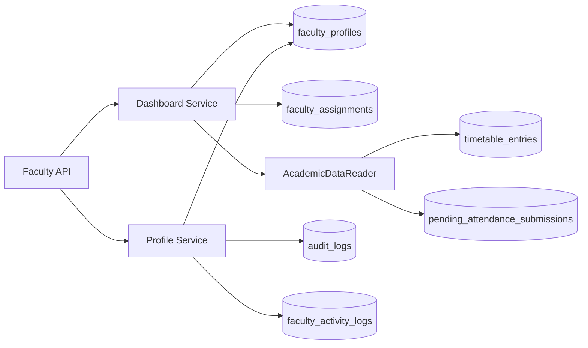

# Faculty / Professor — Phase 1

Phase 1 delivers **Faculty Dashboard & Personal Workspace** and **Faculty Profile & Teaching Responsibilities** for tenant-scoped faculty users (`Role.FACULTY`).

## API surface (`/api/v1/faculty`)

All endpoints use the authenticated faculty identity (`/me/*`). Faculty IDs from clients are not used for authorization.

| Method | Path | Purpose |
|--------|------|---------|
| GET | `/me/dashboard` | Aggregated dashboard (`anchor_date`, `range`) |
| GET | `/me/dashboard/statistics` | Counts for widgets |
| GET | `/me/dashboard/pending-tasks` | Attendance + evaluation queue |
| GET | `/me/dashboard/deadlines` | Paginated deadlines |
| GET | `/me/dashboard/activities` | Paginated recent activity |
| GET | `/me/profile` | Professional profile |
| PATCH | `/me/profile` | Permitted fields only (rate limited) |
| GET | `/me/teaching-responsibilities` | Active assignments |
| GET | `/me/courses` | Alias of active assignments |
| GET | `/me/workload` | Workload + assignments for current term |
| GET | `/me/profile/activity-history` | Paginated profile/audit activity |
| GET | `/me/teaching-responsibilities/history` | Assignment change history |

Permissions: `faculty:self:access`, `faculty:profile:read|update`, `faculty:dashboard:read`, `faculty:teaching:read`.

## Collections

### Faculty-owned

| Collection | Purpose | Key constraints |
|------------|---------|-----------------|
| `faculty_profiles` | Extended profile linked to `users` | Unique `(tenant_id, user_id)`; optional unique `faculty_code` per tenant |
| `faculty_assignments` | Teaching allocations (admin writes; faculty reads) | `allocation_locked=true`; indexed by user + term |
| `faculty_workloads` | Computed workload per term | Unique `(tenant_id, user_id, year, semester)` |
| `faculty_dashboard_preferences` | UI filters/widgets | Unique per user |
| `faculty_activity_logs` | Recent academic actions | TTL not applied; retain per tenant policy |
| `faculty_notifications` | Academic/department messages | Optional TTL on `expires_at` |

### Academic authority (read by faculty)

Owned by Academic Management; faculty aggregates without duplicating writes:

- `academic_year_context`
- `timetable_entries`
- `pending_attendance_submissions`
- `upcoming_assessments`
- `pending_assignment_evaluations`
- `academic_events`

## Integration flow



## Security

- JWT + tenant scope via `AccessScope`
- Faculty-only routes (`require_faculty_scope`)
- Profile PATCH: allowlist fields, `extra=forbid`, Redis rate limit (10/min/user)
- Teaching assignment documents are read-only from the faculty API
- Profile updates recorded in `audit_logs` and `faculty_activity_logs`

## Tests

```bash
cd backend
pytest tests/test_faculty_phase1.py -q
```

## Deferred (Phase 2+)

Attendance submission, grading workflows, admin assignment APIs, HR employee sync, and remaining faculty module catalogue from the product roadmap.
