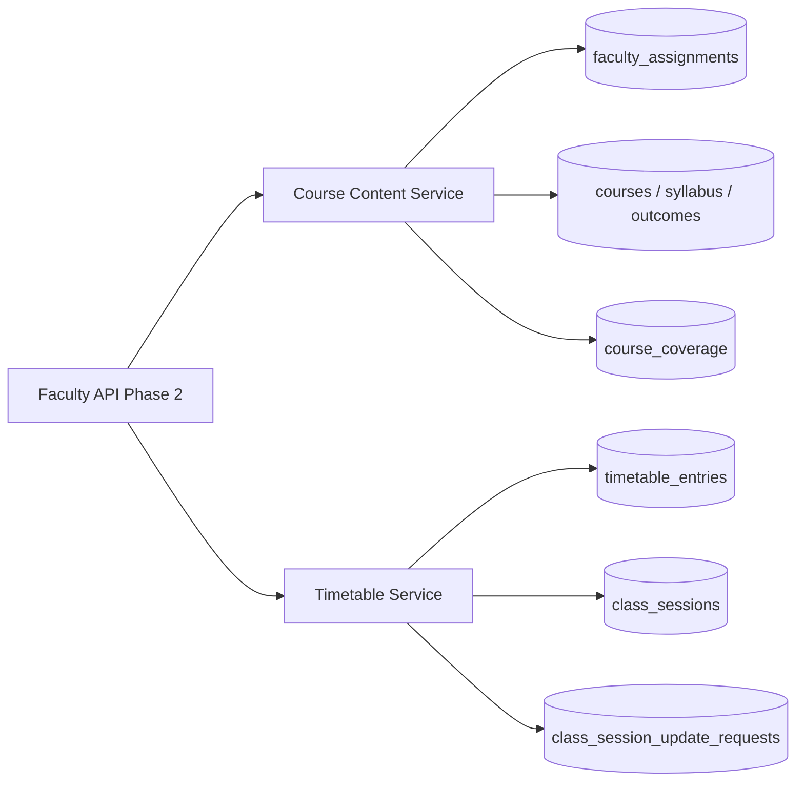

# Faculty / Professor — Phase 2

Phase 2 adds **Course, Subject & Academic Content Management** and **Timetable, Class Sessions & Academic Calendar** for faculty users.

## Collection map

| Prompt name | Implementation |
|-------------|----------------|
| `faculty_course_assignments` | Reuses `faculty_assignments` (Phase 1) |
| `course_subject_mappings` | `course_subject_mappings` |
| `curriculum_records` | `curriculum_records` |
| `syllabus_records` | `syllabus_records` |
| `course_learning_outcomes` | `course_learning_outcomes` |
| `course_coverage` | `course_coverage` (faculty-writable) |
| `timetable_entries` | `timetable_entries` (extended) |
| `class_sessions` | `class_sessions` |
| `academic_calendar_events` | `academic_calendar_events` (renamed from Phase 1 `academic_events`) |
| `faculty_timetable_notifications` | `faculty_timetable_notifications` |

Authoritative course/curriculum/timetable **writes** belong to Academic Management; faculty APIs are read-only except `course_coverage` and **session update requests** (workflow, not direct timetable edits).

## APIs (`/api/v1/faculty/me/...`)

### Academic content

- `GET /academic-content/courses`
- `GET /academic-content/courses/{course_code}`
- `GET /academic-content/courses/{course_code}/subjects`
- `GET /academic-content/courses/{course_code}/syllabus`
- `GET /academic-content/courses/{course_code}/learning-outcomes`
- `GET /academic-content/courses/{course_code}/sections`
- `GET /academic-content/courses/{course_code}/sections/{section}/students`
- `GET|PATCH /academic-content/courses/{course_code}/sections/{section}/coverage`

### Timetable

- `GET /timetable/daily`, `/weekly`
- `GET /timetable/sessions`, `/sessions/history`, `/sessions/cancelled-rescheduled`
- `GET /timetable/classrooms`, `/calendar`, `/examinations`, `/changes`, `/notifications`
- `POST /timetable/sessions/{session_id}/update-requests`

## Permissions

- `faculty:course:read`
- `faculty:coverage:update`
- `faculty:timetable:read`
- `faculty:session:request`

## Security

- `course_access.require_course_access` validates assignment before course/section/student access.
- Syllabus/curriculum documents are `locked`; faculty cannot PATCH them.
- Timetable entries and class sessions are not directly mutable by faculty; changes go through `class_session_update_requests`.
- Student roster exposes only `roll_number`, `display_name`, `student_user_id`.

## Tests

```bash
cd backend
pytest tests/test_faculty_phase2.py tests/test_faculty_phase1.py -q
```

## Architecture


