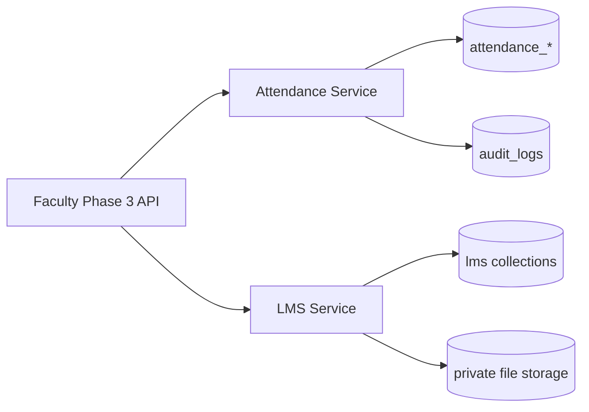

# Faculty / Professor — Phase 3

Phase 3 implements **Attendance Management** and **Assignments, Learning Materials & LMS** for faculty users.

## Central modules

| Module | Responsibility |
|--------|----------------|
| `app/modules/attendance` | Authoritative attendance sessions, records, policies, corrections |
| `app/modules/lms` | Learning materials, course assignments, submissions, evaluations |
| `app/modules/faculty/phase3_router.py` | Faculty-facing HTTP API |

Faculty never bypasses assignment checks; attendance/LMS data stays in central collections.

## Collections

### Attendance

| Collection | Purpose |
|------------|---------|
| `attendance_policy_references` | Configurable weights and minimum % per tenant |
| `attendance_sessions` | One session per class/day/faculty (unique compound index) |
| `attendance_records` | Per-student marks (`present`, `absent`, `late`, `excused`) |
| `attendance_correction_requests` | Approval workflow (`pending/approved/rejected`) |

### LMS

| Collection | Purpose |
|------------|---------|
| `learning_materials` | Uploaded files + metadata (`draft/published`) |
| `assignment_rules` | Formats, size, late/resubmission rules |
| `course_assignments` | Faculty-authored assignments (not `faculty_assignments`) |
| `assignment_submissions` | Student work |
| `assignment_evaluations` | Marks |
| `assignment_feedback` | Text feedback |
| `assignment_resubmission_history` | Authorized resubmissions |

Files stored under `LMS_STORAGE_PATH` (default `data/lms`) with path traversal checks.

## Key APIs

**Attendance** — `/api/v1/faculty/me/attendance/*`  
**LMS** — `/api/v1/faculty/me/lms/*`

See OpenAPI (`/docs`) for the full list (sessions, submit, summaries, shortages, corrections, materials upload/download, assignments, submissions, evaluate, resubmissions).

## Permissions

- `faculty:attendance:read` / `faculty:attendance:manage`
- `faculty:lms:read` / `faculty:lms:manage`

## Policies

- Duplicate submission prevented via session unique index + submitted status guard
- Post-submit edits require correction requests (faculty cannot directly change locked sessions)
- Roster validation on every mark
- Upload allowlist: pdf, office docs, images; max 15MB
- Published assignment deadlines/marks immutable

## Tests

```bash
cd backend
pytest tests/test_faculty_phase3.py -q
```

## Architecture


