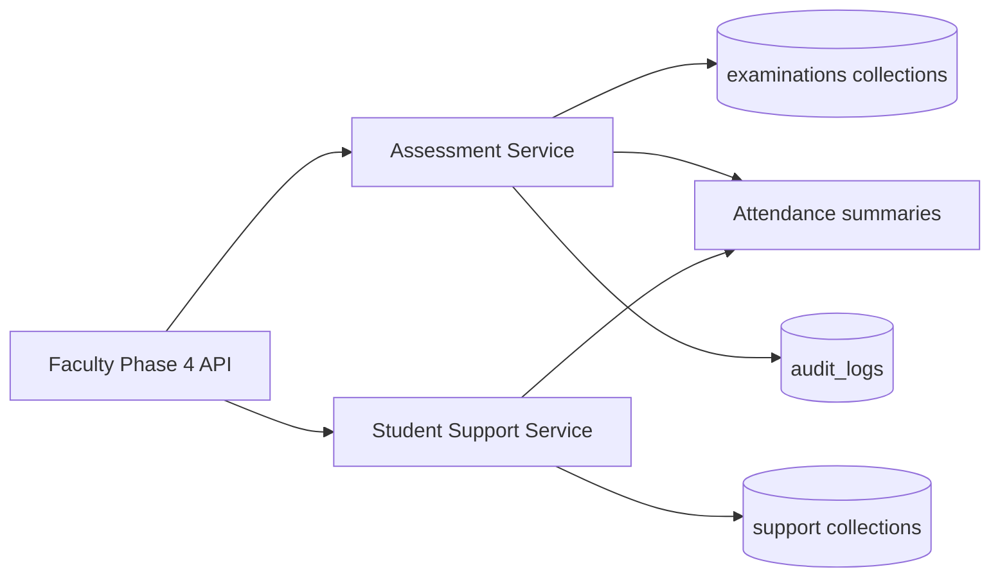

# Faculty / Professor — Phase 4

Phase 4 implements **Assessment, Marks Entry & Grading** and **Student Support, Academic Progress & Mentoring**.

## Central examination module

Authoritative assessment data lives in `app/modules/examinations/`:

| Collection | Purpose |
|------------|---------|
| `grading_policies` | Institutional thresholds and grade bands |
| `assessments` | Assessment master (final publication flags) |
| `assessment_components` | Components, max marks, faculty entry flags |
| `faculty_assessment_assignments` | Faculty ↔ assessment ↔ section |
| `marks_submission_batches` | Draft → pending approval → approved |
| `student_assessment_marks` | Per-student marks |
| `marks_correction_requests` | Post-approval corrections |
| `marks_approval_history` | Workflow audit trail |

Faculty **cannot** enter `is_official_final` components or modify assessments with `final_results_published`.

## Student support collections

| Collection | Purpose |
|------------|---------|
| `student_mentoring_records` | Mentoring notes |
| `student_counselling_sessions` | Restricted counselling summaries |
| `student_academic_followups` | Action items with status |
| `student_improvement_plans` | Improvement goals |
| `academic_performance_snapshots` | Point-in-time aggregates |
| `faculty_academic_reports` | Generated course/student reports |

## APIs

- **Assessment:** `/api/v1/faculty/me/assessments/*` and `/me/assessments/marks/*`
- **Support:** `/api/v1/faculty/me/student-support/*`

## Permissions

- `faculty:assessment:read` / `faculty:assessment:manage`
- `faculty:mentoring:read` / `faculty:mentoring:manage`

## Integration

- Roster eligibility from academics enrollments
- Attendance summaries via Phase 3 attendance service
- Grading letters from `grading_policies` (not hardcoded)
- Marks approval via `examinations/approval.py` (examination cell / admin)

## Tests

```bash
cd backend
pytest tests/test_faculty_phase4.py -q
```

## Architecture


