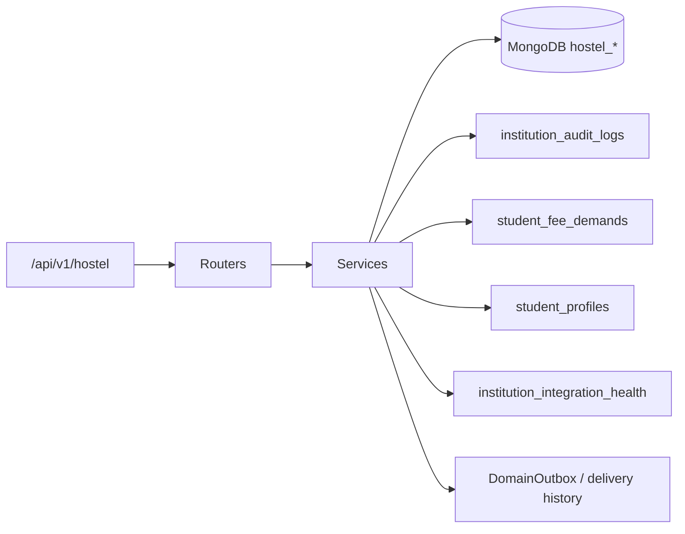

# Hostel Admin — Backend Completion Audit

Audited against `BACKEND_MODULE_COMPLETION_AUDIT_GUIDE.md`, `docs/HOSTEL_PHASE1.md`–`HOSTEL_PHASE7.md`, and repository code under `backend/app/modules/hostel/`.

**Audit date:** 2026-11-19  
**Test environment:** Local (MongoDB unavailable — all `test_hostel_phase*.py` **skipped**)  
**Mount:** `/api/v1/hostel` → `app.modules.hostel.router` (verified in `api/v1/router.py`)

---

## A. Executive summary

| Metric | Value |
|--------|-------|
| Phases reviewed | 7 (HA 01–14 scope) |
| Portal route modules | 16 routers, ~100+ endpoints |
| Beanie hostel-related models | 87 registered (unique, no duplicate class registration) |
| Test files | 7 phase tests — **19 cases skipped** (no MongoDB) |

**Overall status:** **Partially ready for staging verification.** Core CRUD/workflow APIs for infrastructure, allocation, residents, visitors, mess, leave, maintenance, incidents, communication, reports, integrations, audit, and config are implemented and wired with RBAC + tenant scope. Several items remain **partial** (scheduled jobs, PDF export, external webhooks, per-warden scope, full provider sync) by design or deferred scope.

**Fixes applied in this audit pass**

1. `hostel_leave` added to `HOSTEL_AUDIT_MODULES` (leave/outpass audit was invisible in search).
2. Audit dashboard leave counts include `hostel_leave` module.
3. Integration list APIs: sync jobs, failures, events.
4. Configuration list APIs: all sections + policy definitions.
5. Student integration mapping conflict detection (non-retriable failure).

---

## B. Module completion matrix (summary)

| Module (phase) | Feature area | Status | Evidence |
|----------------|--------------|--------|----------|
| P1 HA 01 | Dashboard + drill-down | Complete | `dashboard_router.py`, `dashboard_service.py` |
| P1 HA 02 | Infrastructure CRUD | Complete | `infrastructure_router.py` (prefix `/me/infrastructure`) |
| P2 HA 03–04 | Allocation, applications, waiting list | Complete | `allocation_router.py`, `application_router.py` |
| P3 HA 05, 07 | Residents, visitors | Complete | `resident_router.py`, `visitor_router.py` |
| P4 HA 06, 08 | Mess/billing, leave/outpass | Complete | `mess_router.py`, `leave_outpass_router.py` |
| P5 HA 09–10 | Maintenance, rules/incidents | Complete | `maintenance_router.py`, `rules_incident_router.py` |
| P6 HA 11–12 | Notifications, reports | Partial | CSV export OK; PDF 501 |
| P7 HA 13–14 | Integrations, audit, config | Partial | Manual sync + lists; scheduled/event sync unverified |
| Cross-cutting | RBAC + tenant | Complete | `policy.py`, `deps.hostel_admin_user`, `AccessScope` |
| Cross-cutting | Institution audit | Partial | `record_hostel_audit` in major services; generic `module="hostel"` for some flows |
| Student portal | Hostel self-service | Complete | `student_portal_router.py` hostel routes |
| College admin legacy | `/college-admin/hostel-administration` | Partial | Parallel legacy API; not deprecated in code |

---

## C. API audit

| Finding | Severity | Status after fix |
|---------|----------|----------------|
| Missing GET sync jobs / failures / events (P7 dashboard) | Medium | **Fixed** — `/me/integrations/sync-jobs`, `failures`, `events` |
| Missing GET configuration & policy lists | Medium | **Fixed** — `/me/configuration`, `/me/policies/definitions` |
| PDF report export | Low | **Partial** — 501 in `reports_service.py` (documented) |
| Public webhook ingress with HMAC | Medium | **Partial** — admin-authenticated webhook stub |
| Scheduled report worker | Medium | **Partial** — manual `execute` endpoint only |
| College-admin duplicate hostel APIs | Low | **Unverified** — intentional dual path |

All hostel portal routers are included from `hostel/router.py` and mounted at `/api/v1/hostel`. Routes use `get_access_scope` + `hostel_admin_user` (roles: `HOSTEL_ADMIN`, `COLLEGE_ADMIN`, or effective hostel permissions).

---

## D. Module connection audit

| Connection | Status | Notes |
|------------|--------|-------|
| Hostel → Student profiles | Complete | Resident/visitor/integration student sync |
| Hostel mess → Finance `StudentFeeDemand` | Complete | `send-finance`, `sync-payments`, integration reconciliation |
| Hostel → Notifications (`DomainOutbox`, in-app history) | Complete | `hostel_notify.py`, `communication_service.py` |
| Hostel → Institution audit | Partial | Append-only; search via `HOSTEL_AUDIT_MODULES` |
| Hostel → Institution integrations health | Partial | Binding overlay; no live provider calls without institution config |
| Allocation → Resident auto-create | Complete | `allocation_service` → `hostel_residents` |
| Check-in → `hostel_room_allocations` | Complete | `resident_service.py` |
| Checkout → mess enrollment end | Complete | Phase 4 wiring (per PHASE4 doc) |

---

## E. Database audit

- **87** hostel-related Beanie documents registered once each in `document_models()`.
- Tenant-scoped indexes on operational collections (allocations, beds, integrations, config).
- Partial unique indexes on beds/allocations (phase 2 concurrency) — **Unverified** without integration test run.
- Legacy collections (`hostel_visitor_logs`, college-admin buildings) coexist with portal models — documented.

---

## F. Security and access-control audit

| Item | Status |
|------|--------|
| Tenant from `AccessScope`, not body | Complete |
| Hostel permissions on `Role.HOSTEL_ADMIN` | Complete (incl. P7 permissions) |
| College admin fallback `college:hostel:*` | Complete in `policy.py` |
| Integration secrets | Complete — `signing_secret_ref` only |
| Webhook payloads untrusted | Partial — stored + deduped; no workflow bypass |
| Per-administrator hostel assignment scope | **Missing** — Phase 1 limitation (filters only) |

---

## G. Background jobs and integration audit

| Item | Status |
|------|--------|
| Manual integration sync | Complete |
| Scheduled / event sync | Missing producer |
| Report schedule worker | Missing |
| Reminder scan endpoint | Complete (`/me/notifications/reminders/scan`) — **Unverified** |
| Webhook consumer | Partial — stores events only |

---

## H. Error handling, performance, deployment

- Consistent `AppError` + `ApiResponse` envelope.
- Audit dashboard action-pattern counts cap at 5000 rows (performance guard).
- Reconciliation/sync job lists capped at 200.
- Uvicorn mount verified locally (user terminal); no automated health test run.

---

## I. Test and verification results

```text
py -m pytest tests/test_hostel_phase1.py … test_hostel_phase7.py -q
→ 19 skipped in 16.28s (MongoDB not available)
```

Static verification:

```text
py -c "from app.modules.hostel.router import router" → OK
document_models: 732 unique, HostelMessPlan count 1
```

---

## J. Prioritized action plan

| Priority | Finding | Action | Verification |
|----------|---------|--------|--------------|
| Critical | No runtime test pass | Run hostel suite with MongoDB `rs0` or standalone per `.env.example` | All phase tests green |
| High | Public integration webhooks | Wire institution webhook verifier + tenant token auth | Webhook test without admin JWT |
| High | Scheduled sync/reports | Enqueue to `BackgroundJobRegistry` or existing scheduler | Job appears in ops UI |
| Medium | PDF export | Implement or remove from catalog | Export test |
| Medium | Warden hostel scope | Enforce `hostel_codes` on admin user profile | 403 cross-hostel test |
| Low | Deprecate college-admin hostel routes | Document single portal path | OpenAPI review |

---

## K. Final completion decision

**Partially ready for staging verification.**

Blockers for production review: no executed integration tests, scheduled jobs and external webhooks not end-to-end, PDF export absent, dual college-admin API surface.

Phases 1–7 backend scope is **implemented and connected** for interactive admin workflows; remaining work is operational hardening and test execution, not greenfield feature gaps.

---

## Connection map (hostel portal)

