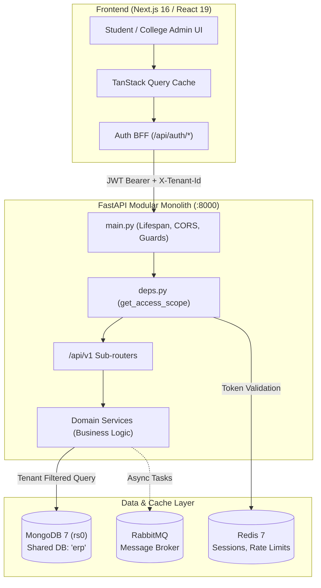
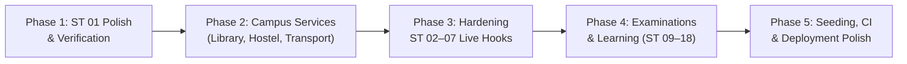

# College ERP — Comprehensive Project Analysis, Architecture & Handoff Brief

> **Target Branch**: `dev-jaswan`  
> **Repository**: `https://github.com/Vasanth117/ERP.git`  
> **UI Source of Truth**: Figma File `ERP` (`fileKey`: `Hy7qeZdVNmzD6PN0ZkgBfK`, ~197 pages)  
> **Scope**: Detailed system analysis, architectural breakdown, current codebase audit, and implementation roadmap.

---

## 1. Executive Summary & Mission

The **College ERP** is a modern, enterprise-grade multi-tenant SaaS platform tailored for Indian higher-education institutions (universities, autonomous engineering colleges, affiliated colleges, and polytechnics). 

A single platform deployment serves:
1. **Super Admin / Platform Operators**: Manages college tenant onboarding, subscriptions, lifecycle (suspension, activation), cross-tenant data governance, and platform health.
2. **Institutions (Tenants)**: Independent colleges operating with strict tenant data isolation, custom branding, and organizational hierarchy.
3. **Institutional Personas & Stakeholders**:
   - **College Admin**: Central executive administration (institution settings, academic years, fee structures, role management).
   - **Department Admin (HOD / Dept Coordinator)**: Departmental curriculum, faculty allocations, section management.
   - **Faculty**: Attendance tracking, CIA entry, syllabus progression, assessments, mentoring.
   - **Student**: Comprehensive student lifecycle portal (admissions, curriculum, timetable, attendance, CIA/exams, fee payments, hostel, library, transport).
   - **Parent**: Ward attendance, academic performance, fee dues, notices.
   - **Operational Cells**: Examination Cell, Finance & Accounts, Library, Hostel, Transport, HR & Payroll.

### Strict Branch Policy
All active work by this agent **must be executed exclusively on branch `dev-jaswan`**.  
- **Do not** checkout, edit, or push to `main` or `dev-vasanth`.
- All features merged from `dev-vasanth` (such as college-admin frontend depth) are already unified into `dev-jaswan`.

---

## 2. Technology Stack Overview

| Layer | Technology | Details & Role in Architecture |
| :--- | :--- | :--- |
| **Backend Framework** | **FastAPI** (Python 3.11+) | Async ASGI web framework; handles high-throughput REST APIs, dependency injection, and automatic OpenAPI schema generation. |
| **Server / Gateway** | **Uvicorn** | ASGI web server running with hot reload in development (`uvicorn app.main:app`). |
| **Database & ODM** | **MongoDB 7** + **Beanie** (Motor) | Document database running with replica set `rs0` for multi-document ACID transactions; Beanie provides async Pydantic document modeling. |
| **Validation & Settings** | **Pydantic v2** & `pydantic-settings` | Strict schema validation, deserialization, and environment parsing from `.env`. |
| **Authentication & Security** | **JWT** + Rotating Refresh Tokens | Access tokens stored in client session memory; refresh tokens stored in secure, `httpOnly` cookies. Password hashes via **Argon2** and **bcrypt**. |
| **Caching & Rate Limiting** | **Redis 7** | Token blacklisting, session tracking, API rate limiting, and temporary cache. |
| **Background Queues** | **Celery** + **RabbitMQ** | Asynchronous task execution for bulk reports, notification fan-outs, and batch exports. |
| **Frontend Framework** | **Next.js 16** (App Router) + **React 19** | Modern server/client component architecture, React compiler support, streaming SSR, and file-based routing. |
| **Type Safety & Language** | **TypeScript 5** | Strict type definitions across frontend features, APIs, and query states. |
| **Styling & Design System** | **Tailwind CSS v4** + **shadcn/ui** | Utility-first CSS, Radix/Base UI accessible primitives, and customized ERP color tokens. |
| **Iconography** | **Lucide** + Custom ERP Icon Set | 1,541 Lucide-based ERP icons synchronized from Figma (`frontend/src/components/icons/erp`). |
| **Data Fetching & Cache** | **TanStack Query v5** | Server-state caching, optimistic updates, query invalidation, and declarative query state handling. |
| **Forms & Validation** | **react-hook-form** + **Zod** | Performant form controls with schema validation matching backend Pydantic models. |
| **Tables & Grids** | **TanStack Table v8** | Headless tabular layouts with sorting, filtering, and pagination. |
| **Local Infrastructure** | **Docker Compose** | Orchestrates MongoDB (replica set init), Redis, and RabbitMQ. |

---

## 3. System Architecture & Data Flow



### 3.1 Multi-Tenancy & Tenant Scoping
- **Shared Database Model**: All tenants reside in the single database `erp`.
- **Row-Level / Document Scoping**: Every institutional collection has a mandatory indexed field `tenant_id: PydanticObjectId`.
- **AccessScope Dependency**: Every protected route injects `scope: Annotated[AccessScope, Depends(get_access_scope)]`. Query predicates strictly enforce `{"tenant_id": scope.tenant_id}`.
- **Tenant Resolution**:
  - Regular users log in with email/username + optional `tenant_code`.
  - If single-college deployment mode is enabled, `LOGIN_DEFAULT_TENANT_CODE` automatically resolves the tenant.
  - Platform Super Admins can operate across colleges by providing the `X-Tenant-Id` header.
- **Zero-Trust Student Identity**: All student routes are mounted under `/api/v1/students/me/*`. The API extracts the user ID directly from the authenticated JWT `sub` and resolves the active student enrollment record. Students cannot pass a foreign `student_id` parameter to tamper with records.

### 3.2 Standard API Envelope
All FastAPI endpoints encapsulate responses in a standard `ApiResponse[T]` envelope:
```json
{
  "success": true,
  "data": { ... },
  "meta": {
    "page": 1,
    "limit": 20,
    "total": 105
  },
  "errors": null,
  "request_id": "req_01h8abc..."
}
```
The frontend envelope client (`frontend/src/lib/api/*`) unwraps `data` and throws typed errors for failed responses.

---

## 4. Codebase Organization & Key Directories

```
D:\ERP\
├── backend/
│   ├── app/
│   │   ├── api/             # FastAPI setup, dependencies (deps.py), /api/v1/router.py
│   │   ├── authorization/   # RBAC permissions (permissions.py), resolver
│   │   ├── common/          # ApiResponse, AccessScope, exceptions, context
│   │   ├── core/            # config.py (.env settings), database.py (Beanie init)
│   │   └── modules/         # Modular domain packages
│   │       ├── academics/           # Courses, terms, curriculum, syllabus
│   │       ├── attendance/          # Session records, daily attendance, shortage
│   │       ├── auth/                # User accounts, tokens, login/logout
│   │       ├── college_admin/       # Institutional backoffice & page services
│   │       ├── department_admin/    # Dept operations, section transfers
│   │       ├── examinations/        # Exam sessions, schedules, hall tickets, marks
│   │       ├── faculty/             # Faculty portal services
│   │       ├── hostel/              # Rooms, allocations, leaves, maintenance
│   │       ├── library/             # Books, circulation, reservations, fines
│   │       ├── platform_*/          # Super Admin tenants, billing, subscriptions
│   │       ├── students/            # Student portal hub (14+ sub-routers)
│   │       └── transport/           # Routes, vehicles, allocations
│   ├── scripts/             # DB seeding, index migrations, user bootstrapping
│   └── tests/               # pytest test suites per module
├── frontend/
│   ├── src/
│   │   ├── app/             # Next.js App Router pages
│   │   │   ├── (auth)/      # Login pages
│   │   │   ├── api/auth/    # Next.js Auth BFF endpoints
│   │   │   ├── college-admin/ # College Admin dashboard pages
│   │   │   └── student/     # Student portal pages (62+ generated routes)
│   │   ├── components/      # UI components, icons, dialogs
│   │   │   └── icons/erp/   # 1,541 Figma-exported ERP Lucide icons
│   │   ├── features/        # Modular frontend features
│   │   │   ├── college-admin/ # Admin hooks, APIs, components
│   │   │   └── student/       # Student feature implementation
│   │   │       ├── api/         # TanStack Query API callers
│   │   │       ├── components/  # Layout, shell, screens, UI panels
│   │   │       ├── config/      # screens.ts, navigation.ts, section-tabs.ts
│   │   │       ├── hooks/       # Custom React query hooks
│   │   │       └── types/       # TypeScript interfaces matching backend models
│   │   └── lib/             # API client, env config, session storage
├── design/                  # Figma metadata, figma.json, figma-pages.json
├── docs/                    # Canonical phase documents and specifications
├── scripts/                 # Route generation, icon export scripts
└── docker-compose.yml       # Local MongoDB, Redis, RabbitMQ services
```

---

## 5. Current Codebase Audit on `dev-jaswan`

### 5.1 Recent Commit History & State
The active branch is `dev-jaswan`. A recent key milestone commit (`35343d6` — *“Student portal and profile updates”*) accomplished:
1. **ST 00 Shell Implementation**: Complete layout parity with Figma ST 00 (`student-sidebar.tsx`, `student-top-header.tsx`, `student-portal-chrome.tsx`, `student-st01-breadcrumbs.tsx`).
2. **ST 01 Profile Architecture**:
   - Built out all sub-profile pages: Personal, Academic, Contact, Guardian, Permitted Edit, Activity Log.
   - Built Profile Correction flow end-to-end: `profile_correction_fields.py`, frontend field validation, submission to backend, college-admin approval hook (`profile_correction_apply.py`).
   - Official Student Record Documents: Implemented `student_record_document_service.py` with multi-document streaming ZIP downloads and viewer screens.
3. **Seed & Bootstrap Enhancements**: Updated `backend/scripts/bootstrap_dev_portal_users.py` with comprehensive student demo data.

### 5.2 Module Completion Matrix

| Module | Backend Status | Frontend Status | Notes |
| :--- | :--- | :--- | :--- |
| **Platform / Super Admin** | **100% Complete** (Phases 1–5) | Operational | Tenant lifecycle, onboarding, billing, system health. |
| **College Admin** | **100% Complete** (Phases 1–12) | **Extensive Coverage** | Merged from `dev-vasanth`. Uses `*_page_service.py` dashboard-shaped JSON. |
| **Department Admin** | **Complete** (Phases 1–10) | Partial / Targeted | Department workflows, section transfers, allocations. |
| **Faculty Portal** | **Complete** (Phases 1–5) | Operational | Dashboard, timetable, attendance marking, CIA entry. |
| **Student Portal: ST 00 (Shell)** | **100% Complete** | **100% Complete** | Sidebar, top header, mobile responsive drawer, module tabs. |
| **Student Portal: ST 01 (Dashboard/Profile)** | **100% Complete** | **100% Complete** | Profile views, edit requests, document download, dashboard KPIs. |
| **Student Portal: ST 02–07 (Academics/Assessments)** | **100% Complete** | **Wired with Hooks** | Academics, curriculum, registration, timetable, attendance, CIA, continuous assessment wired via `student-screen.tsx`. |
| **Student Portal: ST 08 / Campus Services** | **100% Complete** in `student_portal_router.py` | **Pending Screen Wiring** | Library, Hostel, Transport, Student Services Hub, Reports exist on backend; currently point to `/under-construction` or `return null` in frontend router. |
| **Examination Cell** | **Complete** (Phases 1–9) | Functional | Exam cycles, hall ticket generation, marks processing. |
| **Library Management** | **Complete** (Phases 1–12) | Operational | Catalog, RFID/barcode circulation, reservations, fines. |
| **Hostel Management** | **Complete** (Phases 1–7) | Operational | Blocks, rooms, student applications, outpasses, complaints. |
| **Transport Management** | **Complete** | Operational | Routes, stops, bus allocations, tracking. |
| **Finance & Fees** | **Complete** (Phases 1–12) | Operational | Fee structures, student ledgers, online payment receipts. |

---

## 6. Detailed Analysis of the Student Portal

The Student Portal represents the primary consumer surface currently under active development on `dev-jaswan`.

### 6.1 Backend API Mounting
All student sub-routers are mounted in `backend/app/modules/students/router.py`:
- `curriculum_router` (`/me/curriculum/*`): Programmes, course outlines, prerequisites, learning outcomes.
- `timetable_attendance_router` (`/me/timetable/*`, `/me/attendance/*`): Daily/weekly schedules, session records, shortages, discrepancy requests.
- `assessment_router` (`/me/assessments/*`, `/me/cia/*`): CIA schedules, marks breakdown, assignments, quizzes, rubrics.
- `practical_examination_router` & `semester_examination_router`: Lab schedules, external exam timetables.
- `examination_registration_router` & `examination_results_router`: Exam applications, hall tickets, publishable semester results.
- `academic_grading_router` (`/me/grades/*`): SGPA/CGPA calculations, transcripts, grade cards.
- `academic_document_router` (`/me/documents/*`): Certificates, bonafide requests, marksheets.
- `arrear_backlog_router` (`/me/arrears/*`): Arrear tracking and supplementary exam registration.
- `exam_review_router` (`/me/revaluation/*`): Photocopy and revaluation applications.
- `student_lms_router` (`/me/lms/*`): Study materials, course modules, lecture notes.
- `student_finance_router` (`/me/finance/*`): Dues breakdown, fee transactions, payment receipts.
- `student_portal_router` (`/me/portal/*`): Phase 10 campus services (Library, Hostel, Transport, Services Hub, Reports, Announcements).

### 6.2 Frontend Architecture (`frontend/src/features/student/`)
- **Navigation & Sitemaps**:
  - `config/sidebar-navigation.ts`: Sidebar groups (Overview, Academics, Examinations, Learning & Finance, Campus & Services, Communication).
  - `config/screens.ts`: Granular route catalog mapping ~62 slugs to titles, descriptions, and Figma nodes.
  - `config/section-tabs.ts`: Top horizontal navigation tabs for each major module context.
- **Dynamic Screen Dispatcher**:
  - `components/student-screen.tsx`: Matches URL slug to the corresponding screen component (`AcademicsScreen`, `CurriculumScreen`, `TimetableScreen`, `AttendanceScreen`, `CiaScreen`, `ContinuousAssessmentScreen`).
- **UI Primitives**:
  - Built with consistent styling: `PageHeading`, `SectionPanel`, `QueryState`, `StatusBadge`, `DetailRow`.

### 6.3 The Campus Services Gap (Immediate Next Focus)
While **Continuous Assessment** (Figma page ST 08) was wired up with `ContinuousAssessmentScreen`, the backend endpoints for **Phase 10 Campus Services** (`student_portal_router.py`) are ready but pending frontend screens:
1. **Library**:
   - Backend: `/api/v1/students/me/library/catalogue/search`, `/borrowed-books`, `/reservations`, `/fines`, `/digital-resources`.
   - Frontend State: Sidebar routes to `/under-construction?module=student-library`.
2. **Hostel / Residence**:
   - Backend: `/api/v1/students/me/residence/hostel/status`, `/apply`, `/room-allocation`, `/maintenance/complaints`, `/leave-outpass`.
   - Frontend State: Sidebar routes to `/under-construction?module=student-hostel`.
3. **Transport**:
   - Backend: `/api/v1/students/me/residence/transport/routes`, `/allocation`, `/schedules`, `/fee-details`.
   - Frontend State: Sidebar routes to `/under-construction?module=student-transport`.
4. **Services Hub & Reports**:
   - Backend: `/api/v1/students/me/services/list`, `/submit`, `/reports/generate`, `/reports/history`.
   - Frontend State: Unmapped in `student-screen.tsx`.

---

## 7. Strategic Implementation Roadmap for `dev-jaswan`



### Phase 1: ST 01 Polish & Flow Verification
1. **Profile Correction End-to-End Test**:
   - Student submits correction for permitted fields (`date_of_birth`, `personal_email`, `guardian_phone`, etc.).
   - College Admin views pending requests in College Admin portal (`/college-admin/students/profile-corrections`).
   - College Admin approves/rejects; verify background update of `StudentProfile` and audit trail.
2. **Record Documents Streaming**:
   - Verify single and bulk ZIP download of official admission documents via `student_record_document_service.py`.

### Phase 2: Campus & Services UI Implementation (Highest Impact)
1. **API Client & Hooks**:
   - Create `frontend/src/features/student/api/library.ts`, `hostel.ts`, `transport.ts`, `services.ts`.
   - Create TanStack Query hooks: `use-student-library.ts`, `use-student-hostel.ts`, `use-student-transport.ts`.
   - Add query keys to `frontend/src/features/student/query-keys.ts`.
2. **Screen Component Packages**:
   - `frontend/src/features/student/components/screens/library-screens.tsx`:
     - Catalog search with book availability.
     - Issued books list, return due dates, and fine payments.
     - Digital e-book downloads.
   - `frontend/src/features/student/components/screens/hostel-screens.tsx`:
     - Room allocation card and hostel rules.
     - Outpass and leave application form.
     - Maintenance complaint submission with photo attachment.
   - `frontend/src/features/student/components/screens/transport-screens.tsx`:
     - Route picker, bus schedule, stops timetable, and bus pass download.
3. **Route Registration & Wiring**:
   - Add screen definitions to `frontend/src/features/student/config/screens.ts`.
   - Update `studentSidebarNav` in `sidebar-navigation.ts` to point directly to `/student/...` routes instead of `/under-construction`.
   - Wire slugs into `student-screen.tsx`.
   - Execute `py scripts/generate_student_app_routes.py` to generate Next.js route files.

### Phase 3: ST 02–07 Hardening & Real Data Testing
- Replace any remaining placeholder data in `AcademicsScreen`, `CurriculumScreen`, `TimetableScreen`, `AttendanceScreen`, and `CiaScreen` with live TanStack Query hooks.
- Handle edge cases: zero attendance records, empty timetable during vacations, arrears warning banners.

### Phase 4: Examinations, Results & Finance UI
- Build screens for Examination Registration, Hall Ticket PDF download, Semester Marksheet viewing, SGPA/CGPA cards, and Fee receipt payment tracking.

---

## 8. Developer Runbook & Environment Setup

### 8.1 Prerequisites
- Python 3.11+
- Node.js 20+ (with npm)
- Docker Desktop (for MongoDB, Redis, RabbitMQ)
- Git (configured on branch `dev-jaswan`)

### 8.2 Starting Local Infrastructure
```powershell
# From repo root D:\ERP
docker compose up -d mongodb mongo-init redis rabbitmq
```
Verify MongoDB replica set:
```powershell
docker exec -it erp-mongodb mongosh --eval "rs.status().ok"
```

### 8.3 Starting the Backend API
```powershell
cd D:\ERP\backend

# Activate virtual environment
.\.venv\Scripts\Activate.ps1

# Ensure dependencies are installed
pip install -r requirements.txt

# Run Beanie index migration (mandatory after model changes)
python -m scripts.migrate_indexes

# Run the API server
uvicorn app.main:app --host 0.0.0.0 --port 8000 --reload
```
- Swagger API Docs: `http://localhost:8000/docs`
- OpenAPI JSON: `http://localhost:8000/openapi.json`

### 8.4 Starting the Frontend
```powershell
cd D:\ERP\frontend

# Ensure dependencies are installed
npm install

# Start Next.js development server
npm run dev
```
- Application URL: `http://localhost:3000`
- Student Portal: `http://localhost:3000/student/home`

### 8.5 Database Seeding & Test Credentials
Run the bootstrap scripts to create dev tenants and users:
```powershell
cd D:\ERP\backend
.\.venv\Scripts\Activate.ps1

# 1. Bootstrap College Admin & tenant structure
python scripts/bootstrap_dev_college_admin.py

# 2. Bootstrap Student & Faculty test portal users
python scripts/bootstrap_dev_portal_users.py
```
Default Development Credentials (from `frontend/src/lib/auth/dev-login-defaults.ts`):
- **Super Admin**: `superadmin@erp.local` / `Admin@12345`
- **College Admin**: `admin@demo-college.edu` / `Admin@12345` (Tenant: `DEMO`)
- **Student**: `student@demo-college.edu` / `Student@12345` (Tenant: `DEMO`)
- **Faculty**: `faculty@demo-college.edu` / `Faculty@12345` (Tenant: `DEMO`)

### 8.6 Generating Student Routes
Whenever new screens or routes are added to `frontend/src/features/student/config/screens.ts`:
```powershell
cd D:\ERP
py scripts/generate_student_app_routes.py
```
This automatically updates Next.js App Router folders under `frontend/src/app/student/`.

---

## 9. Figma Integration & Design Conventions

The project uses Figma as the absolute single source of truth for UI layouts, design tokens, typography, and spacing.

- **Figma Design URL**: `https://www.figma.com/design/Hy7qeZdVNmzD6PN0ZkgBfK/ERP`
- **File Key**: `Hy7qeZdVNmzD6PN0ZkgBfK`
- **Page Catalog**: `design/figma-pages.json`
- **Synchronizing Catalog**:
  ```powershell
  python scripts/build_figma_pages_catalog.py
  ```
- **Icon Set Export**:
  ```powershell
  python scripts/export_figma_erp_icon_library.py
  ```

### Design-to-Code Workflow
When implementing new screens:
1. Inspect the Figma node ID using the Figma plugin / MCP (`get_design_context` or `get_metadata` with `fileKey: Hy7qeZdVNmzD6PN0ZkgBfK`).
2. Adhere to design tokens:
   - Primary blue: `#2563eb` (accent `#1d4ed8`)
   - Neutral backgrounds: `#f8fafc` (page), `#ffffff` (card/panel)
   - Borders: `#e2e8f0` / `#f1f5f9`
   - Text: `#0f172a` (primary), `#475569` (secondary), `#94a3b8` (muted)
3. Maintain consistency with existing `StudentPortalChrome`, `SectionPanel`, and `QueryState` components.

---

## 10. Agent Operating Guidelines & Guardrails

When working on this repository, any automated agent must adhere to the following principles:

1. **Branch Exclusivity**:
   - Always verify active branch is `dev-jaswan` (`git branch --show-current`).
   - Never run `git checkout main`, `git checkout dev-vasanth`, or push to those branches.
2. **Tenant Scoping Discipline**:
   - Never write an un-scoped database query on institutional models. Always filter by `tenant_id=scope.tenant_id`.
3. **Envelope Consistency**:
   - All new backend endpoints must return `ApiResponse[T]` using `success_response(...)`.
4. **Frontend Architecture Patterns**:
   - Never perform raw `fetch` calls directly in screen components. Use typed API callers in `features/<module>/api/` and wrap with TanStack Query hooks.
   - All query keys must be registered in `query-keys.ts`.
5. **No Secret Commits**:
   - Never commit `.env`, local workflow notes, or credentials to git.
   - Keep canonical specifications inside `docs/`.

---

*Document compiled and audited for branch `dev-jaswan`.*
