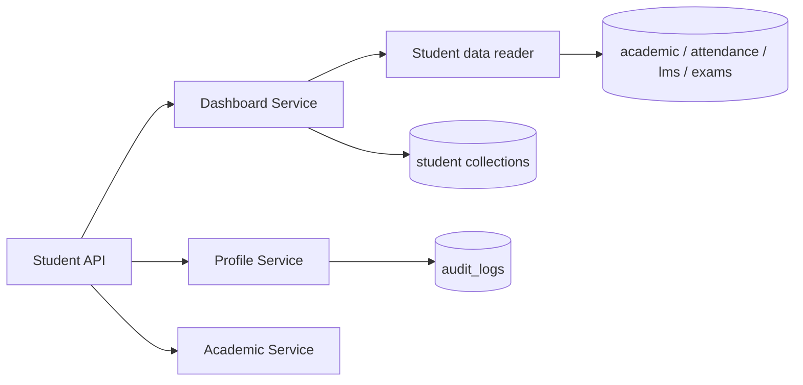

# Student Portal — Phase 1 (Dashboard, Profile, Academic & Enrollment)

## Scope

- **Module 1:** Student dashboard and profile (`/api/v1/students/me/*`)
- **Module 2:** Academic management and enrollment (read + permitted enrollment requests)

Students access **only their own** records via authenticated `user_id` and `tenant_id`. Client-supplied student IDs are not used for authorization.

## Collections

| Collection | Purpose |
|---|---|
| `student_profiles` | Admission identity (read-only official fields) + permitted contact fields |
| `student_academic_records` | Locked term standing, eligibility, fee snapshot |
| `student_enrollments` | Approved enrollment lines per term |
| `student_enrollment_history` | Closed term summaries |
| `student_dashboard_preferences` | Widget and filter preferences |
| `student_academic_requests` | Student-submitted enrollment change requests |
| `student_activity_logs` | Portal activity trail |

### Indexes (high level)

- Unique `(tenant_id, user_id)` on profiles and dashboard preferences
- Unique roll number per tenant (partial, when set)
- Academic record unique per `(tenant_id, user_id, year, semester)`
- Enrollment and request lists by `(tenant_id, user_id, status/time)`
- Activity log by `(tenant_id, user_id, created_at)`

### Retention

- Activity logs: align with tenant retention policy (default: keep 2 academic years; purge via governance jobs)
- Academic requests: retain for accreditation / audit minimum 7 years
- Profiles: retained while user account is active

## Integrations (read-only)

| Source module | Data |
|---|---|
| Academics | `academic_year_context`, `timetable_entries`, `examination_schedules`, `academic_calendar_events` |
| Curriculum / enrollment | `enrollment_rosters` (fallback when `student_enrollments` empty) |
| Attendance | `attendance_sessions`, `attendance_records`, policy |
| LMS | Published `course_assignments`, student `assignment_submissions` |
| Examinations | Approved `student_assessment_marks` |
| Communication | Published announcements via `communication_recipients` |
| Finance | `student_academic_records.fee_snapshot` until Finance APIs exist |

## API summary

| Method | Path | Permission |
|---|---|---|
| GET | `/students/me/dashboard` | `student:dashboard:read` |
| GET | `/students/me/dashboard/statistics` | `student:dashboard:read` |
| GET | `/students/me/dashboard/activities` | `student:dashboard:read` |
| GET | `/students/me/dashboard/pending-tasks` | `student:dashboard:read` |
| GET | `/students/me/dashboard/notifications` | `student:dashboard:read` |
| GET/PATCH | `/students/me/profile` | read / update |
| GET | `/students/me/academics` | `student:academic:read` |
| GET | `/students/me/academics/enrollment-history` | `student:enrollment:read` |
| GET | `/students/me/academics/status` | `student:enrollment:read` |
| GET | `/students/me/academics/eligibility` | `student:academic:read` |
| POST | `/students/me/academics/enrollment-requests` | `student:enrollment:request` |
| GET | `/students/me/academics/enrollment-requests` | `student:enrollment:read` |
| GET | `/students/me/academics/enrollment-requests/{id}` | `student:enrollment:read` |

Rate limits: profile PATCH (10/min), enrollment request POST (5/5min) via Redis.

## Tests

```bash
cd backend
pytest tests/test_student_phase1.py tests/test_permissions.py -q
```

## Architecture


