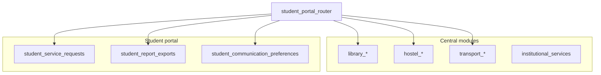

# Student Portal — Phase 10 (Campus Services + Communication & Reports)

Completes planned student backend phases (1–10).

## Central authority (department-owned — students read or submit; no duplication)

| Domain | Collections |
|--------|-------------|
| Library | `library_catalog_items`, `library_copies`, `library_circulations`, `library_reservations`, `library_fines`, `library_digital_resources` |
| Hostel | `hostel_applications`, `hostel_room_allocations`, `hostel_notices`, `hostel_service_requests` |
| Transport | `transport_routes`, `transport_stops`, `transport_schedules`, `transport_allocations`, `transport_service_requests`, `transport_notifications` |
| Service catalog | `institutional_services` |
| Communication (reuse) | `faculty_announcements`, `communication_recipients`, `academic_calendar_events`, `examination_announcements` |
| Documents (reuse) | `academic_document_publications`, `student_academic_document_requests` (Phase 7) |

## Student portal collections

| Collection | Purpose |
|------------|---------|
| `student_service_requests` | Unified portal requests (links to official ids when applicable) |
| `student_service_request_history` | Status timeline |
| `student_hostel_request_references` | Portal ↔ `hostel_service_requests` |
| `student_transport_request_references` | Portal ↔ `transport_service_requests` |
| `student_library_activity_views` | Catalogue / digital browse audit |
| `student_communication_preferences` | Email/push/category toggles |
| `student_notification_read_status` | Read/unread keys across sources |
| `student_document_references` | Authorized non-academic docs |
| `student_document_requests` | Certificate / bonafide requests |
| `student_profile_correction_requests` | Official field correction workflow |
| `student_report_exports` | Personal report jobs + storage key |
| `student_report_download_logs` | Report download audit |

Retention: portal request/report logs — align with tenant retention policy (default 90d operational; reports expire in 7 days via `expires_at`).

## Permissions

- `student:library:read`
- `student:residence:read` / `manage` (hostel & transport requests)
- `student:services:read` / `manage`
- `student:communication:read` / `manage`
- `student:reports:read` / `manage`

## API routes (prefix `/api/v1/students`, `student_portal_router`)

**Library:** `/me/library/catalogue`, `/books/{id}/availability`, `/issued`, `/due-dates`, `/overdue`, `/reservations`, `/fines`, `/digital`, `/history`

**Hostel:** `/me/hostel/application`, `/allocation`, `/notices`, `POST /requests`, `GET /requests/{id}`

**Transport:** `/me/transport/routes`, `/allocation`, `/routes/{id}/stops`, `/schedules`, `/fees`, `POST /requests`, `/notifications`

**Services:** `/me/services`, `POST|GET /services/requests`, `/history`, `/academic-requests`

**Communication:** `/me/announcements`, `/me/notifications`, `POST /notifications/{key}/read`, `/communication/preferences`, `/documents/*`, `/profile-corrections`

**Reports:** `GET /me/reports`, `POST /me/reports/generate`, `GET /me/reports/{export_id}`, `GET .../download?token=`

## Security

- All queries filter `tenant_id` + `student_user_id` (or roster where relevant).
- Hostel/transport allocation: unique per student in central collections; other students cannot read.
- Report downloads: Redis single-use tokens (15 min), JSON stored under `student_report_storage_path`.
- Academic document downloads: reuse Phase 7 expiring token flow.
- Rate limit: `student_portal_request_rate_limit` on submissions.
- Audit: hostel/transport/service requests, document & profile correction requests, report generate/download.

## Architecture



## Tests

```bash
cd backend
py -m pytest tests/test_student_portal_phase10.py tests/test_permissions.py -q
```

Integration tests require MongoDB + Redis (otherwise skipped).
