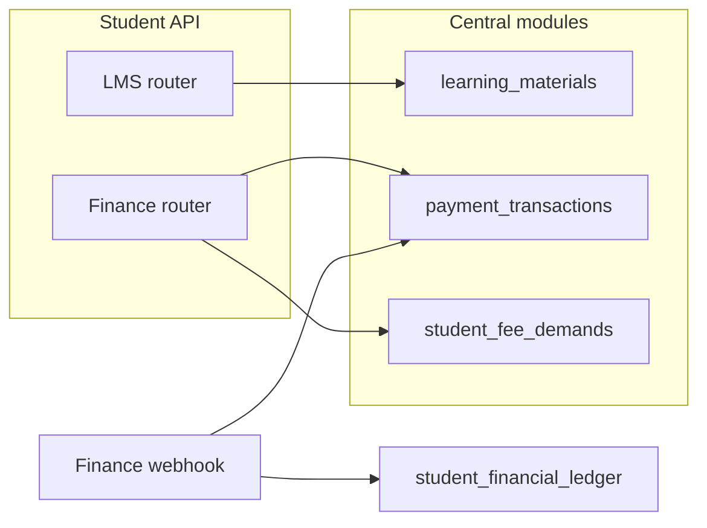

# Student Portal — Phase 9 (LMS + Fees / Finance)

## Central authority (reuse — students read or pay; never mutate official ledger directly)

| Domain | Collections |
|--------|-------------|
| LMS materials & assignments | `learning_materials`, `course_assignments`, `assignment_submissions`, `assignment_evaluations`, `assignment_feedback`, `assignment_rules` |
| Fees & ledger | `student_fee_structures`, `student_fee_demands`, `student_fee_invoices`, `student_financial_ledger`, `payment_transactions`, `payment_receipts`, `fee_installment_schedules` |
| Scholarships & refunds | `scholarship_programs`, `student_scholarship_eligibility`, `official_scholarship_applications`, `fee_concessions`, `refund_records` |
| Announcements | `faculty_announcements`, `communication_recipients` |

### Student portal collections

| Collection | Purpose |
|------------|---------|
| `student_learning_progress` | Per-course activity counters (materials, assignments, quizzes) |
| `student_material_access_logs` | Audit of material views / download token issuance |
| `student_lms_preferences` | Optional LMS UI preferences |
| `student_lms_notification_logs` | Learning-related notifications |
| `student_payment_attempts` | Links idempotency keys to `payment_transactions` |
| `student_scholarship_applications` | Portal copy of scholarship submissions |
| `student_financial_document_references` | Receipt / finance doc view tracking |
| `student_payment_notification_logs` | Fee reminders and payment notices |
| `student_fee_view_preferences` | Optional fee portal preferences |

**Not duplicated:** fee demands, invoices, ledger entries, official scholarship decisions, and payment truth — owned by `app/modules/finance/finance_models.py`.

## Permissions

- `student:lms:read` / `student:lms:manage` (download token, assignment submit, quiz participation)
- `student:finance:read` / `student:finance:manage` (pay fees, apply for scholarships)
- Existing `student:continuous_assessment:read` still powers shared assignment/quiz reads under `/me/assessments/*`

## API routes (prefix `/api/v1/students`)

### LMS (`student_lms_router`)

- `GET /me/lms/materials` — enrolled, published materials (`course_code`, `subject_id`, `unit_no`)
- `GET /me/lms/recorded-lectures`
- `POST /me/lms/materials/{material_id}/download-token` — Redis expiring token (15 min)
- `GET /me/lms/materials/{material_id}/download?token=` — one-time file delivery
- `GET /me/lms/announcements`
- `GET /me/lms/assignments`, `GET /me/lms/assignments/{id}`, `POST /me/lms/assignments/{id}/submit` (multipart)
- `GET /me/lms/assignments/{id}/submission`, `GET /me/lms/assignments/{id}/feedback`
- `GET /me/lms/quizzes`, `POST /me/lms/quizzes/{id}/participate`
- `GET /me/lms/progress`, `GET /me/lms/assessment-progress`, `GET /me/lms/notifications`

### Finance (`student_finance_router`)

- `GET /me/finance/fee-structure`, `/demands`, `/invoices`, `/outstanding`
- `POST /me/finance/payments/initiate` — idempotent (`idempotency_key`)
- `GET /me/finance/payments/{transaction_id}/status`
- `POST /me/finance/payments/{transaction_id}/refresh` — post-webhook reconciliation read
- `GET /me/finance/payments/history`
- `GET /me/finance/receipts`, `POST /me/finance/receipts/{receipt_id}/viewed`
- `GET /me/finance/installments`, `/concessions`, `/refunds`, `/ledger`, `/reminders`
- `GET /me/finance/scholarships/eligibility`
- `POST /me/finance/scholarships/applications`, `GET .../applications/{application_id}`

### Payment webhook (central finance router, prefix `/api/v1/finance`)

- `POST /webhooks/payments` — HMAC `X-Payment-Signature`; updates `payment_transactions`, then `payment_reconciliation` (demand paid, ledger credit, receipt)

## Security

- Materials: roster-enrolled course/section only; downloads via private storage + single-use Redis token
- Assignments: same enrollment gate; `lms.storage.validate_upload`; no cross-student submission access
- Payments: client success ignored until `webhook_verified`; duplicate pay blocked per demand; idempotency on `payment_transactions` and `student_payment_attempts`
- Finance reads scoped to `student_user_id` on every query
- Tenant isolation on all student and finance documents
- Audit: material download token, assignment submit, payment initiate, scholarship submit, receipt view

## Tests

```bash
cd backend
py -m pytest tests/test_student_lms_finance.py tests/test_permissions.py -q
```

Integration tests require MongoDB + Redis (otherwise skipped). Permission assertions run without Docker.

## Architecture note


